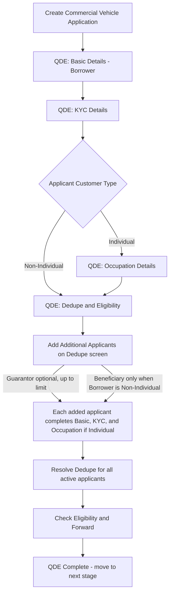

# Commercial Vehicle QDE Requirements

## Source Basis

- Salesforce LOS codebase under `force-app/main/default`.
- QDE stage metadata from `Dynamic_Stage_Gate` custom metadata for Wheels.
- QDE UI components including `createApplication`, `applicantBasicDetailsCapture`, `wheelsIndividualKYCMasterPage`, `customerDedupeMasterPage`, and related Apex controllers.
- Field mapping template from `Field Details.xlsx`.

## Excel Field Details Table

The table below follows the same headers as `Field Details.xlsx` so it can be copied into the Excel mapping file.

| Field Name | Object | Field Type | Drop down values | Display Stage | Display Sub Stage | Display Section | Validation | Error Message | Controlling field | Controlling Expression |
| --- | --- | --- | --- | --- | --- | --- | --- | --- | --- | --- |
| Product Type | `Application__c.Product__c` | Picklist | Commercial Vehicle or CV product option from Salesforce picklist | QDE | Basic Details | Application Details | Required; selected as Commercial Vehicle during application creation. | Select a product to continue. |  |  |
| Vehicle Type | `Asset__c.Vehicle_type__c` | Text | New; Used; Refinance | QDE | Basic Details | Application Details | Required for Commercial Vehicle asset creation. | Select vehicle type to continue. |  |  |
| Number of Vehicles | `Application_Line_Item__c.Number_of_Vehicles__c` | Picklist | Single; Multiple | QDE | Basic Details | Application Details | Required; displayed from primary application line item. | Number of vehicles is required. |  |  |
| Customer Type | `Applicant__c.Type__c` | Picklist | Individual; Non-Individual | QDE | Basic Details | Application Details | Required; drives Individual versus Non-Individual field visibility. | Select Customer Type. |  |  |
| Applicant Type (Entity Type) | `Applicant__c.Entity_Type__c` | Picklist | Pvt Ltd; Public Ltd; Business Entities Created by Statute; Proprietorship; Partnership; Trust; HUF; Co-Operative Society; Assosication of Persons; Government | QDE | Basic Details | Application Details | Required for Non-Individual applicants. | Select Entity Type. | Customer Type | Visible and editable when Customer Type = Non-Individual. |
| Entity Name | `Applicant__c.Company_Name__c` | Text |  | QDE | Basic Details | Application Details | Required for Non-Individual applicants. | Enter Entity Name. | Customer Type | Required when Customer Type = Non-Individual. |
| Industry Name | `Applicant__c.Industry_Name__c` | Text | `Industry_Code_and_Type__c` active records | QDE | Basic Details | Application Details | Required for Commercial Vehicle Non-Individual applicants; options sourced from `Industry_Code_and_Type__c`. | Select Industry Name. | Product Type + Customer Type | Visible when Product Type is CV/SCV/LCV/MHCE/CE and Customer Type = Non-Individual. |
| Industry Code | `Applicant__c.Industry_Code__c` | Text |  | QDE | Basic Details | Application Details | Auto-populated from selected Industry Name and shown read-only. |  | Industry Name | Derived from selected `Industry_Code_and_Type__c` record. |
| Primary Applicant | `Applicant__c.Is_Primary__c` | Checkbox | Yes; No | QDE | Basic Details | Application Details | Required for top-level non-borrower applicants; sole role member defaults to primary. | Select whether applicant is primary. | Applicant Role | Shown for top-level non-borrower applicants only. |
| Beneficial Owner Category | `Applicant__c.Beneficial_Owner_Category__c` | Picklist | Beneficial Owner; Controlling Person; Authorised Signatory; Beneficial Owner cum Co-borrower | QDE | Basic Details | Application Details | Required for beneficiary under Non-Individual applicant. | Select Beneficial Owner Category. | Applicant Role + Customer Type | Visible when applicant is Beneficiary and Customer Type = Non-Individual. |
| Relationship with Entity | `Applicant__c.Relationship_with_Entity__c` | Picklist | SHAREHOLDER; HOLDING COMPANY; SUBSIDIARY COMPANY; PROPRIETOR; PARTNER; TRUSTEE; PROMOTER DIRECTOR; NOMINEE DIRECTOR; INDEPENDENT DIRECTOR; DIRECTOR - SINCE RESIGNED; OTHER | QDE | Basic Details | Application Details | Required for beneficiary under Non-Individual applicant. | Select Relationship with Entity. | Applicant Role + Customer Type | Visible when applicant is Beneficiary and Customer Type = Non-Individual. |
| Relationship Type | `Applicant__c.Relationship_Type__c` | Picklist | BUSINESS ENTITY REGISTERED IN INDIA; RESIDENT INDIAN INDIVIDUAL; BUSINESS ENTITY REGISTERED OUTSIDE INDIA; FOREIGN or NON RESIDENT INDIVIDUAL | QDE | Basic Details | Application Details | Required for beneficiary under Non-Individual applicant. | Select Relationship Type. | Applicant Role + Customer Type | Visible when applicant is Beneficiary and Customer Type = Non-Individual. |
| POA Holder | `Applicant__c.POA_Holder__c` | Checkbox | Yes; No | QDE | Basic Details | Application Details | Optional flag for beneficiary or authorized relationship capture. |  | Applicant Role + Customer Type | Visible when applicant is Beneficiary and Customer Type = Non-Individual. |
| Shareholder % | `Applicant__c.ShareHolding__c` | Percent |  | QDE | Basic Details | Application Details | Required for beneficiary; must not make combined beneficiary shareholding exceed 100%; must satisfy configured minimum when present. | Shareholding cannot exceed 100%; Total combined beneficiary shareholding cannot exceed 100%; Shareholding must be at least configured minimum. | Applicant Role + Customer Type | Visible when applicant is Beneficiary and Customer Type = Non-Individual. |
| Branch | `Application__c.Branch__c` | Lookup (Account) |  | QDE | Basic Details | Loan Basic Info | Required; selected using Account record picker. | Select Branch. |  |  |
| Purpose of Purchase | `Asset__c.Purpose_of_purchase__c` | Picklist | Personal; Commercial | QDE | Basic Details | Loan Basic Info | Defaults to Commercial for Commercial Vehicle products; editable when field is shown. | Select Purpose of Purchase. | Product Type | Shown for non-PL products; defaults by product. |
| Required Loan Amount | `Application__c.Total_Loan_Amount__c` | Currency |  | QDE | Basic Details | Loan Detail | Required; numeric amount accepted by UI; persisted to Application and mirrored to primary Application Line Item customer requested amount. | Enter required loan amount. |  |  |
| Customer Requested Loan Amount | `Application_Line_Item__c.Customer_Requested_Loan_Amount__c` | Number |  | QDE | Basic Details | Loan Detail | System mirror of Required Loan Amount for primary line item. |  | Required Loan Amount | Updated when Required Loan Amount is saved. |
| Profile Type | `Applicant__c.Profile__c` | Picklist | Salesforce active picklist values; see `Field Details.xlsx` for full list. | QDE | Basic Details | Professional Detail | Captured for Individual applicants. | Select Profile Type. | Customer Type | Visible when Customer Type = Individual. |
| Income Available | `Applicant__c.Is_Income_Available__c` | Picklist | Yes; No | QDE | Basic Details | Professional Detail | Required for Individual applicants; forced to Yes for Non-Individual applicants. | Select Income Available. | Customer Type | Editable for Individual applicants; set to Yes for Non-Individual applicants. |
| Annual Income | `Applicant__c.Declared_income__c` | Currency |  | QDE | Basic Details | Professional Detail | Required when Income Available = Yes for Individual applicants. | Enter annual income. | Income Available + Customer Type | Visible when Customer Type = Individual and Income Available = Yes. |
| Occupation Category | `Applicant__c.Income_Category__c` | Picklist | Salaried; Self Employed Professional; Self Employed Non Professional; Non-Earning | QDE | Basic Details | Professional Detail | Required for Individual applicants once Income Available is selected; auto set to Non-Earning when Income Available = No. | Select Occupation Category. | Income Available + Customer Type | Visible when Customer Type = Individual and Income Available is Yes or No. |
| Evaluation Type | `Applicant__c.Evaluation_Type__c` | Picklist | Captive Retail; Captive strategic; Hiring FTU; Hiring Retail; Hiring Strategic; Not Applicable | QDE | Basic Details | Professional Detail | Captured for Non-Individual applicants. | Select Evaluation Type. | Customer Type | Visible when Customer Type = Non-Individual. |
| Is PAN Available | `Applicant__c.Is_PAN_Available__c` | Picklist | Yes; No | QDE | Basic Details | Document Verification | Required; forced to Yes when Annual Income exceeds 400000, Required Loan Amount exceeds 1000000, or applicant is Non-Individual. | PAN is mandatory when Annual Income exceeds 4 Lakhs or Required Loan Amount exceeds 10 Lakhs or Non-individual applicant. | Annual Income + Required Loan Amount + Customer Type | Readonly or forced Yes when PAN mandatory rule is true. |
| PAN Card Upload | `Document_CheckList__c.ContentVersionId__c` | Text |  | QDE | Basic Details | Document Verification | Required when Is PAN Available = Yes. | Upload PAN Card File. | Is PAN Available | Visible and required when Is PAN Available = Yes. |
| Form 60 Upload | `Document_CheckList__c.ContentVersionId__c` | Text |  | QDE | Basic Details | Document Verification | Required when Is PAN Available = No. | Upload Form 60 File. | Is PAN Available | Visible and required when Is PAN Available = No. |
| First Name | `Document_CheckList__c.First_Name__c` | Text |  | QDE | Basic Details | Document Verification | Required for Individual PAN/Form 60 path; copied to Applicant first name on save. | Enter First Name. | Customer Type + Is PAN Available | Visible for Individual applicants on PAN/Form 60 identity capture. |
| Last Name | `Document_CheckList__c.Last_Name__c` | Text |  | QDE | Basic Details | Document Verification | Required for Individual PAN/Form 60 path; copied to Applicant last name on save. | Enter Last Name. | Customer Type + Is PAN Available | Visible for Individual applicants on PAN/Form 60 identity capture. |
| Entity / Company Name | `Applicant__c.Company_Name__c` | Text |  | QDE | Basic Details | Document Verification | Captured for Non-Individual PAN path; aligned with Entity Name. | Enter entity or company name. | Customer Type + Is PAN Available | Visible for Non-Individual applicants when PAN details are captured. |
| Date of Birth | `Document_CheckList__c.KYC_Date_of_Birth__c` | Date |  | QDE | Basic Details | Document Verification | Required for Individual applicants; age must be between 18 and 80 years. | Applicant must be at least 18 years old; Applicant cannot be older than 80 years. | Customer Type | Visible for Individual applicants. |
| Date of Incorporation | `Applicant__c.Date_of_Birth__c` | Date |  | QDE | Basic Details | Document Verification | Captured for Non-Individual applicants as incorporation date. | Enter date of incorporation. | Customer Type | Visible for Non-Individual applicants. |
| PAN Card Number | `Document_CheckList__c.PAN_No__c` | Text |  | QDE | Basic Details | Document Verification | Required when Is PAN Available = Yes; validated by PAN format and PAN fourth-character master rule before verification. | PAN Card Number is not valid. | Is PAN Available | Visible and required when Is PAN Available = Yes. |
| Applicant PAN Number | `Applicant__c.PAN_Number__c` | Text |  | QDE | Basic Details | Document Verification | Persisted applicant PAN value after PAN capture or verification. |  | PAN Card Number | Updated from PAN detail capture. |
| PAN Acknowledgement Number | `Document_CheckList__c.PAN_ACK_No__c` | Text |  | QDE | Basic Details | Document Verification | Required when Form 60 path is used and Form 60 file is uploaded. | Enter PAN Acknowledgement Number. | Is PAN Available + Form 60 Upload | Visible when Is PAN Available = No and Form 60 file is uploaded. |
| Gender | `Document_CheckList__c.Gender__c` | Picklist | MALE; FEMALE; OTHERS MALE; OTHERS FEMALE; OTHERS PREFER NOT TO DISCLOSE | QDE | Basic Details | Document Verification | Required on Form 60 path for Individual applicants. | Select Gender. | Is PAN Available + Customer Type | Visible when Is PAN Available = No and Customer Type = Individual. |
| Marital Status | `Applicant__c.Marital_status__c` | Picklist | DIVORCEE; MARRIED; SINGLE PARENT; UNMARRIED; WIDOW; WIDOWER; Null | QDE | Basic Details | Contact Info | Captured for Individual applicants. | Select Marital Status. | Customer Type | Visible when Customer Type = Individual. |
| Residence Country | `Applicant__c.Residence_Country__c` | Picklist | India; Non-India Resident | QDE | Basic Details | Contact Info | Captured for Individual applicants. | Select Residence Country. | Customer Type | Visible when Customer Type = Individual. |
| Mobile Number | `Applicant__c.Phone__c` | Phone |  | QDE | Basic Details | Contact Info | Required contact number; must be an Indian mobile number pattern used by the UI. | Enter a valid mobile number. |  |  |
| Email | `Applicant__c.Email__c` | Email |  | QDE | Basic Details | Contact Info | Required email when captured; validated by UI email pattern. | Enter a valid email address. |  |  |
| Contact Person Name | `Applicant__c.Contact_Person_Name__c` | Text |  | QDE | Basic Details | Contact Info | Captured for Non-Individual applicants. | Enter Contact Person Name. | Customer Type | Visible when Customer Type = Non-Individual. |
| Landline Number | `Applicant__c.Landline_Number__c` | Phone |  | QDE | Basic Details | Contact Info | Captured for Non-Individual applicants; UI formats Indian STD style. | Enter valid landline number. | Customer Type | Visible when Customer Type = Non-Individual. |
| Application Consent Received | `Applicant__c.Application_Consent_Received__c` | Checkbox | Yes; No | QDE | Basic Details | Contact Info | Consent must be obtained through generated customer consent link or OTP flow before completion where configured. | Applicant consent is pending. | Consent Link | Updated by ApplicationConsent customer flow. |
| Customer Code | `Applicant__c.Customer_Code__c` | Text |  | QDE | Dedupe and Eligibility | Customer Dedupe | System-populated when a dedupe match is marked valid or customer match is resolved. | Select a customer match or mark Valid before checking eligibility. | Dedupe Match | Updated when Valid Match integration resolves CIF/customer code. |
| Invalid Customer Code | `Applicant__c.Invalid_Customer_Code__c` | Text |  | QDE | Dedupe and Eligibility | Customer Dedupe | System-populated when a dedupe match is marked invalid. |  | Dedupe Match | Updated when Invalid Match action is saved. |
| Current Loan Stage Complete | `Applicant__c.Current_Loan_Stage_Complete__c` | Text |  | QDE | Dedupe and Eligibility | Stage Completion | Tracks applicant-level completion; all applicants must complete prior QDE steps before borrower can proceed. | Complete Lead Details, Basic Details, and KYC Details for added applicant(s) before proceeding. | Applicant Stage Navigation | Set by dynamic stage navigation when applicant completes step. |

## Agile Requirements Hierarchy

### Epic: Commercial Vehicle Loan Origination

Enable Commercial Vehicle loan origination in Salesforce LOS by supporting a complete QDE journey for applicant capture, document handling, KYC, customer dedupe, and eligibility readiness.

### Feature: QDE Stage for Commercial Vehicle Loans

Provide a guided QDE stage that orchestrates Basic Details, KYC Details, Occupation Details, and Dedupe and Eligibility for Commercial Vehicle loan applications using the existing Wheels stage framework. The flow adapts to the applicant's customer type: Individual applicants complete Occupation Details, while Non-Individual applicants skip it and move from KYC Details directly to Dedupe and Eligibility. Additional applicants (Guarantors, and Beneficiaries for Non-Individual borrowers) are added from the Dedupe and Eligibility screen and must each complete their own QDE steps.

## User Stories

### US-CV-QDE-001: QDE Master Flow and Sub-Stage Transitions

**User Story Description:** As a Sales Officer, I want to follow a guided QDE flow that adapts to the applicant's customer type so that I capture the right information for Individual and Non-Individual Commercial Vehicle applications in the correct order.

**Acceptance Criteria:**

- **Positive Scenario**
  - Given an Individual Commercial Vehicle application
  - When the Borrower completes Basic Details and KYC Details
  - Then the system presents Occupation Details next, followed by Dedupe and Eligibility
- **Positive Scenario**
  - Given a Non-Individual Commercial Vehicle application
  - When the Borrower completes Basic Details and KYC Details
  - Then the system skips Occupation Details and presents Dedupe and Eligibility next
- **Positive Scenario**
  - Given a new Commercial Vehicle application
  - When QDE begins
  - Then the system always starts with the Borrower and captures the Borrower's details first
- **Negative Scenario**
  - Given a required QDE sub-stage is incomplete
  - When the user attempts to proceed to the next sub-stage
  - Then the system prevents the transition and shows the incomplete stage status
- **Edge Case Scenario**
  - Given additional applicants have been added on the Dedupe and Eligibility screen
  - When the Borrower attempts to complete Dedupe and Eligibility
  - Then the system requires every active applicant to complete their own prior QDE steps and dedupe before QDE can be completed
- **Edge Case Scenario**
  - Given the user revisits a completed QDE sub-stage
  - When the stage is already marked complete
  - Then the system presents the completed information in a review or read-only state unless reopening is explicitly allowed
- **Field Mapping Scenario**
  - Given any QDE sub-stage is displayed
  - When fields are rendered
  - Then the fields displayed in this section must match the specifications in the provided Excel mapping

**Assumptions:**

- The QDE journey for Commercial Vehicle follows the business-agreed order: Basic Details, KYC Details, Occupation Details, and Dedupe and Eligibility.
- Individual applicants complete Occupation Details, while Non-Individual applicants do not; the business confirms this difference.
- QDE always starts with the Borrower; any other applicants (Guarantors, and Beneficiaries for Non-Individual borrowers) are added later, during Dedupe and Eligibility.
- Dedupe and Eligibility is the final QDE step; after it the application moves to the next stage, which is handled in a separate feature.

**Integrations:**

- None — this story covers QDE stage navigation only and does not call any external API.

**In Scope:**

- QDE sub-stage sequencing.
- Customer-type routing, including Non-Individual skipping Occupation Details.
- Completion gating across the Borrower and all added applicants before QDE completes.

**Out of Scope:**

- Manual override of the configured stage sequence.
- Bulk reassignment of already completed QDE stages.

### US-CV-QDE-002: Create and Open Commercial Vehicle QDE Application

**User Story Description:** As a Sales Officer, I want to create a Commercial Vehicle application so that I can begin the QDE process from the generated application record.

**Acceptance Criteria:**

- **Positive Scenario**
  - Given the user selects Commercial Vehicle and completes the required setup selections
  - When the user clicks Create
  - Then the system creates the application and opens the new application record
- **Negative Scenario**
  - Given required setup selections are missing
  - When the user clicks Create
  - Then the system blocks creation and displays an actionable message
- **Edge Case Scenario**
  - Given product setup data cannot be loaded
  - When the create application page opens
  - Then the system shows an error state and does not create partial application data
- **Field Mapping Scenario**
  - Given setup fields are displayed
  - When the create application screen loads
  - Then the fields displayed in this section must match the specifications in the provided Excel mapping

**Assumptions:**

- Commercial Vehicle is an approved loan product and is available for selection during application creation.
- The business accepts that creating an application starts a draft that can be continued later.
- Creating a Commercial Vehicle application establishes the initial Borrower so QDE capture can begin.

**Integrations:**

- None — application creation does not call any external API.

**In Scope:**

- Create Application UI behavior.
- Initial Commercial Vehicle application record creation.
- Navigation to the created application.

**Out of Scope:**

- Editing product setup after application creation from this screen.
- Duplicate application warning rules not already available in QDE.

### US-CV-QDE-003: Capture Basic Details UI Sections

**User Story Description:** As a Sales Officer, I want to capture Basic Details through guided UI sections so that the QDE record has the required applicant and loan information.

**Acceptance Criteria:**

- **Positive Scenario**
  - Given the application is in QDE Basic Details
  - When the user completes the visible sections and clicks Next
  - Then the system saves the data and moves to the next QDE sub-stage
- **Negative Scenario**
  - Given a visible required section is incomplete
  - When the user clicks Next
  - Then the system blocks progression and identifies the incomplete section
- **Edge Case Scenario**
  - Given the user changes a controlling selection
  - When dependent sections are refreshed
  - Then the system clears or hides values that no longer apply
- **Field Mapping Scenario**
  - Given Basic Details sections are displayed
  - When the application, loan, professional, document, and contact sections render
  - Then the fields displayed in this section must match the specifications in the provided Excel mapping

**Assumptions:**

- The set of Basic Details sections and their visibility rules are reviewed and signed off by business and are reflected in the Excel mapping.
- Field-level rules such as mandatory fields and dependent visibility are owned by the Excel mapping that business approves.
- A section is treated as complete only when its required information has been provided.

**Integrations:**

- None — Basic Details capture does not call any external API. Identity and verification APIs are covered in their own stories.

**In Scope:**

- Basic Details section visibility.
- Save and Next button behavior.
- Required section completion checks.

**Out of Scope:**

- Free-text override of hidden or non-applicable fields.
- Manual bypass of client-side section completion checks.

### US-CV-QDE-004: Add and Manage Additional Applicants (Guarantor and Beneficiary)

**User Story Description:** As a Sales Officer, I want to add and manage additional applicants from the Dedupe and Eligibility screen so that Guarantors and, for Non-Individual borrowers, Beneficiaries are captured for the Commercial Vehicle application.

**Acceptance Criteria:**

- **Positive Scenario**
  - Given the Borrower is on the Dedupe and Eligibility screen and the guarantor limit has not been reached
  - When the user chooses to add a Guarantor
  - Then the system creates a Guarantor applicant and lets the user indicate whether that Guarantor is Individual or Non-Individual
- **Positive Scenario**
  - Given the Borrower is a Non-Individual entity
  - When the user chooses to add a Beneficiary
  - Then the system creates a Beneficiary applicant; this option is available only when the Borrower is Non-Individual
- **Positive Scenario**
  - Given an additional applicant has been added
  - When the user opens that applicant
  - Then the system requires that applicant to complete their own Basic Details, KYC Details, Occupation Details (only if that applicant is Individual), and dedupe resolution
- **Negative Scenario**
  - Given the maximum number of Guarantors or Beneficiaries has been reached
  - When the user attempts to add another applicant of that type
  - Then the system prevents adding and informs the user that the limit is reached
- **Negative Scenario**
  - Given a Non-Individual borrower requires a minimum number of Beneficiaries for its constitution
  - When the user attempts to proceed without meeting that minimum
  - Then the system blocks progression and indicates how many Beneficiaries are required
- **Edge Case Scenario**
  - Given an added applicant is no longer required
  - When the user removes that applicant
  - Then the system removes the applicant and updates the applicant list
- **Field Mapping Scenario**
  - Given additional-applicant fields are displayed
  - When the add-applicant screen renders
  - Then the fields displayed in this section must match the specifications in the provided Excel mapping

**Assumptions:**

- For Commercial Vehicle, the additional applicant types are Guarantor(s) and, only for Non-Individual borrowers, Beneficiary(ies). There is no Co-Guarantor role, and the Co-Borrower role applies only to Two-Wheeler products and is therefore not used for Commercial Vehicle.
- The maximum number of Guarantors and Beneficiaries, and the minimum number of Beneficiaries required for each Non-Individual constitution, are defined and signed off by business.
- Each added applicant can itself be Individual or Non-Individual and then follows the same QDE rules as the Borrower.
- Every active applicant must complete their QDE steps and dedupe before the application can move past QDE.

**Integrations:**

- None — adding an applicant does not call an external API. Verification, KYC, dedupe, and eligibility APIs are invoked when each applicant completes their own steps (covered in the related stories).

**In Scope:**

- Add Guarantor behavior and the Add Beneficiary option for Non-Individual borrowers.
- Guarantor and Beneficiary limit enforcement and minimum-beneficiary checks.
- Remove applicant behavior and applicant list management.

**Out of Scope:**

- Co-Borrower capture (applicable to Two-Wheeler products only).
- Any Co-Guarantor role (not supported in the system).

### US-CV-QDE-005: Upload, Preview, Replace, and Delete QDE Documents

**User Story Description:** As a Sales Officer, I want to upload and manage QDE documents so that required identity and supporting documents are attached to the correct applicant.

**Acceptance Criteria:**

- **Positive Scenario**
  - Given the document upload card is visible
  - When the user uploads a supported file
  - Then the system attaches the file to the correct document checklist item and displays upload confirmation
- **Positive Scenario**
  - Given a document is uploaded
  - When the user clicks Preview
  - Then the system opens a preview of the selected document
- **Negative Scenario**
  - Given a required document has not been uploaded
  - When the user clicks Next
  - Then the system blocks progression and indicates the upload requirement
- **Edge Case Scenario**
  - Given multiple files are uploaded for the same document slot
  - When the user expands the file list
  - Then the system displays the uploaded files with available preview or delete actions
- **Field Mapping Scenario**
  - Given document upload fields are displayed
  - When the document verification screen renders
  - Then the fields displayed in this section must match the specifications in the provided Excel mapping

**Assumptions:**

- The allowed document types and file formats are agreed by business and listed in the Excel mapping.
- The required documents for each applicant type are defined and signed off by business.
- The business accepts the document preview, replace, and delete behavior offered during QDE.

**Integrations:**

- None — document upload uses internal document storage and does not call any external API.

**In Scope:**

- Upload button behavior.
- File preview.
- File delete or replacement behavior where enabled.
- Checklist association for QDE documents.

**Out of Scope:**

- New document viewer features.
- Offline file upload.
- Manual file virus review.

### US-CV-QDE-006: Verify PAN, Form 60, OTP, and Consent Actions

**User Story Description:** As a Sales Officer, I want to trigger verification and consent actions from QDE so that applicant identity and authorization steps are completed before progression.

**Acceptance Criteria:**

- **Positive Scenario**
  - Given the PAN verification action is available
  - When the user clicks Verify after entering the required information
  - Then the system runs the verification and updates the verification status
- **Positive Scenario**
  - Given consent is required
  - When the user sends the consent link or OTP and the customer completes the action
  - Then the system refreshes and displays the updated consent status
- **Negative Scenario**
  - Given verification fails or consent is pending
  - When the user attempts to proceed
  - Then the system blocks progression and displays the relevant pending status
- **Edge Case Scenario**
  - Given a verification link or OTP session has expired
  - When the customer attempts verification
  - Then the system prevents completion and requires a valid verification path
- **Field Mapping Scenario**
  - Given verification and consent fields are displayed
  - When the screen renders
  - Then the fields displayed in this section must match the specifications in the provided Excel mapping

**Assumptions:**

- Business confirms which identity verifications (for example PAN or Aadhaar) are mandatory before the applicant can progress.
- Customer consent must be captured before the application proceeds, and the consent wording is owned and approved by business.
- The validity period for a verification link or OTP is agreed by business.

**Integrations:**

- PAN Verification API
- Aadhaar eKYC OTP (UIDAI) API
- Phone OTP API
- Email OTP API

**In Scope:**

- PAN verification button behavior.
- OTP send and verification action behavior.
- Customer consent link generation and status refresh.

**Out of Scope:**

- Changes to OTP provider contracts.
- Consent wording management.
- Biometric verification.

### US-CV-QDE-007: Complete KYC Details for Individual and Non-Individual Applicants

**User Story Description:** As a Sales Officer, I want the KYC Details screen to adapt to whether the applicant is Individual or Non-Individual so that the correct KYC information is captured for each applicant and the flow routes to the right next step.

**Acceptance Criteria:**

- **Positive Scenario**
  - Given the applicant is Individual
  - When the user opens KYC Details
  - Then the system displays the Individual KYC screen
- **Positive Scenario**
  - Given the applicant is Non-Individual
  - When the user opens KYC Details
  - Then the system displays the Non-Individual KYC screen
- **Positive Scenario**
  - Given KYC Details are complete for an Individual applicant
  - When the user clicks Next
  - Then the system moves the applicant to Occupation Details
- **Positive Scenario**
  - Given KYC Details are complete for a Non-Individual applicant
  - When the user clicks Next
  - Then the system moves the applicant directly to Dedupe and Eligibility, skipping Occupation Details
- **Negative Scenario**
  - Given KYC details are incomplete
  - When the user clicks Next
  - Then the system prevents progression and displays the incomplete KYC status
- **Edge Case Scenario**
  - Given the application has multiple applicants
  - When the user completes KYC for one applicant
  - Then the system updates only that applicant's KYC completion and keeps the other applicants pending until completed
- **Field Mapping Scenario**
  - Given KYC Details are displayed
  - When the Individual or Non-Individual KYC screen renders
  - Then the fields displayed in this section must match the specifications in the provided Excel mapping

**Assumptions:**

- KYC is captured for each applicant individually.
- Individual and Non-Individual applicants see different KYC information, as agreed and signed off by business.
- After KYC, Individual applicants continue to Occupation Details and Non-Individual applicants continue directly to Dedupe and Eligibility.

**Integrations:**

- CIF on PAN API
- ETB CASA API
- Customer Dedupe API
- Validate Recent Lead API
- Aadhaar eKYC OTP (UIDAI) API

**In Scope:**

- Individual versus Non-Individual KYC screen selection.
- KYC Next routing based on customer type.
- Applicant-level KYC completion and status handling.

**Out of Scope:**

- New KYC document categories not configured in the current checklist model.
- Manual override of failed KYC verification.

### US-CV-QDE-008: Capture Occupation Details for Individual Applicants

**User Story Description:** As a Sales Officer, I want to capture Occupation Details for Individual applicants so that occupation and income information is recorded before Dedupe and Eligibility.

**Acceptance Criteria:**

- **Positive Scenario**
  - Given an Individual applicant has completed KYC Details
  - When the user opens the Occupation Details step
  - Then the system displays the Occupation Details screen and allows the information to be captured
- **Positive Scenario**
  - Given Occupation Details are complete for an Individual applicant
  - When the user clicks Next
  - Then the system moves the applicant to Dedupe and Eligibility
- **Negative Scenario**
  - Given Occupation Details are incomplete
  - When the user clicks Next
  - Then the system prevents progression and displays the incomplete status
- **Edge Case Scenario**
  - Given an applicant is Non-Individual
  - When the QDE menu is presented for that applicant
  - Then the Occupation Details step is not shown for that applicant
- **Edge Case Scenario**
  - Given a Non-Individual application includes an Individual applicant (for example an Individual Guarantor)
  - When that Individual applicant's QDE is in progress
  - Then the system presents the Occupation Details step for that Individual applicant
- **Field Mapping Scenario**
  - Given Occupation Details are displayed
  - When the Occupation Details screen renders
  - Then the fields displayed in this section must match the specifications in the provided Excel mapping

**Assumptions:**

- Occupation Details apply only to Individual applicants; Non-Individual applicants skip this step.
- The occupation and income information required, and which entries are mandatory, are agreed and signed off by business.
- Occupation Details completion is a prerequisite for an Individual applicant to reach Dedupe and Eligibility.

**Integrations:**

- None — Occupation Details capture does not call any external API.

**In Scope:**

- Occupation Details screen behavior for Individual applicants.
- Skip behavior for Non-Individual applicants.
- Save and Next routing to Dedupe and Eligibility.

**Out of Scope:**

- Detailed income assessment performed in later stages.
- Occupation capture for Non-Individual applicants (not applicable).

### US-CV-QDE-009: Run Customer Dedupe Actions

**User Story Description:** As a Sales Officer, I want to review and resolve customer dedupe results so that duplicate or existing customer matches are handled before eligibility.

**Acceptance Criteria:**

- **Positive Scenario**
  - Given dedupe results are available
  - When the user marks a result as Valid or Invalid
  - Then the system saves the dedupe decision and updates the applicant's dedupe status
- **Negative Scenario**
  - Given no dedupe result has been resolved
  - When the user attempts to continue to eligibility
  - Then the system blocks the action and prompts the user to resolve dedupe first
- **Edge Case Scenario**
  - Given the application has additional applicants
  - When the Borrower attempts to proceed
  - Then the system validates dedupe completion for every active applicant (Borrower, Guarantor(s), and Beneficiary(ies) where present)
- **Field Mapping Scenario**
  - Given dedupe-related fields are displayed
  - When the dedupe screen renders
  - Then the fields displayed in this section must match the specifications in the provided Excel mapping

**Assumptions:**

- Dedupe must be reviewed and resolved for every required applicant.
- Business has defined how a matched customer is confirmed (Valid) or rejected (Invalid).
- Dedupe resolution is a prerequisite before eligibility can be run.

**Integrations:**

- Customer Dedupe API
- Valid Match / Invalid Match API

**In Scope:**

- Dedupe result display.
- Valid and Invalid button behavior.
- Applicant-level dedupe completion validation.

**Out of Scope:**

- Tuning external matching logic.
- Manual customer master data correction from the QDE screen.

### US-CV-QDE-010: Run Eligibility and Forward Actions

**User Story Description:** As a Sales Officer, I want to run eligibility and forward actions from QDE so that the application can complete QDE after required checks succeed.

**Acceptance Criteria:**

- **Positive Scenario**
  - Given dedupe is complete
  - When the user clicks Check Eligibility
  - Then the system runs the eligibility checks and displays progress to the user
- **Positive Scenario**
  - Given eligibility and required forward actions complete successfully
  - When the user clicks Next
  - Then the system marks QDE as complete
- **Negative Scenario**
  - Given an eligibility or forward action fails
  - When the user attempts to continue
  - Then the system displays the failure and prevents completion until the action is retried or resolved
- **Edge Case Scenario**
  - Given the applicant is Non-Individual
  - When eligibility is run
  - Then the system follows the Non-Individual eligibility path defined for QDE
- **Field Mapping Scenario**
  - Given eligibility-related fields or statuses are displayed
  - When the eligibility screen renders
  - Then the fields displayed in this section must match the specifications in the provided Excel mapping

**Assumptions:**

- The bureau and eligibility checks used depend on customer type (for example CIBIL for Individual and CRIF for Non-Individual), as agreed by business.
- Eligibility must complete successfully before QDE can be marked complete.
- The progress of each eligibility check is shown to the user while it runs.

**Integrations:**

- NPA Check API
- CIBIL API
- CRIF API
- BRE (Business Rule Engine) Check Eligibility API
- AML Check API
- ScoreCard API
- Get Existing EMI API
- Get Exposure Details API

**In Scope:**

- Check Eligibility button behavior.
- Integration progress display behavior.
- Retry or failure display behavior available in QDE.
- QDE completion action after successful checks.

**Out of Scope:**

- New eligibility rules engine design.
- Manual editing of integration responses.

### US-CV-QDE-011: Preserve QDE Navigation, Save State, and Read-Only Review

**User Story Description:** As a Sales Officer, I want QDE to preserve saved data and completion states so that I can safely navigate between applicants and sub-stages without losing progress.

**Acceptance Criteria:**

- **Positive Scenario**
  - Given the user saves a QDE section
  - When the user navigates away and returns
  - Then the system reloads the saved values and completion state
- **Negative Scenario**
  - Given a save action fails
  - When the user attempts to navigate away
  - Then the system displays the save failure and does not mark the section complete
- **Edge Case Scenario**
  - Given an applicant is started but never completed
  - When the user navigates away before saving required Basic Details
  - Then the system handles the incomplete applicant according to the agreed cleanup behavior
- **Field Mapping Scenario**
  - Given any saved QDE section is reloaded
  - When the screen renders
  - Then the fields displayed in this section must match the specifications in the provided Excel mapping

**Assumptions:**

- Saved information is retained when users move between sub-stages and applicants.
- Completed sub-stages are presented for review without accidental loss of data.
- The business accepts that an applicant who is started but never saved may be discarded.

**Integrations:**

- None — navigation and save-state behavior does not call any external API.

**In Scope:**

- Save state reload.
- Read-only review for completed stages.
- Navigation across QDE sub-stages and applicant tabs.

**Out of Scope:**

- Offline draft mode.
- Concurrent multi-user edit conflict resolution beyond existing Salesforce behavior.

## Clarifying Questions

1. For Commercial Vehicle, what is the maximum number of Guarantors allowed, and can a Guarantor be a Non-Individual entity? (The system supports both; please confirm the business limits and rules for CV.)
2. For Non-Individual Commercial Vehicle borrowers, should the minimum and maximum Beneficiary counts be driven entirely by the configured constitution rules, or are there Commercial Vehicle-specific overrides?
3. Should Occupation Details be mandatory for Individual Guarantors/Beneficiaries as well, or only for the Borrower?
4. Should integration failure retries on Dedupe and Eligibility be user-triggered only, or should QDE support automatic retry for transient failures?
