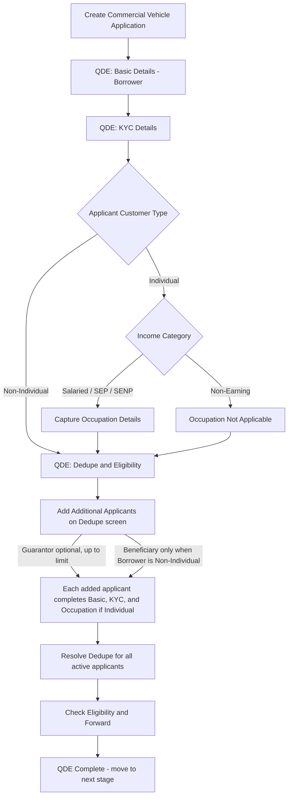

# Commercial Vehicle QDE Requirements

## Source Basis

- Salesforce LOS codebase under `force-app/main/default`.
- QDE stage metadata from `Dynamic_Stage_Gate` custom metadata for Wheels.
- QDE UI components including `createApplication`, `applicantBasicDetailsCapture`, `wheelsIndividualKYCMasterPage`, `customerDedupeMasterPage`, and related Apex controllers.
- Field mapping template from `Field Details.xlsx`.
- Occupation field scope and current mandatory flags from all three sheets in `Occupation Mandatory fields.xlsx`: Salaried, Self-Employed Professional, and Self-Employed Non-Professional.
- Live QDE validation using Commercial Vehicle application CV-1498 through QDE completion and navigation to DDE Asset Details.

### Source Interpretation

- `Currently Mandatory?` in `Occupation Mandatory fields.xlsx` is treated as the current business requirement because `Mandatory Final` is blank for every supplied row.
- Code and metadata define the implemented object/API mapping, picklist values, visibility, validation, and integration behavior.
- The live CV-1498 journey validates the Individual Non-Earning route. Earning Occupation variants are documented from the workbook and code because they were not displayed in that live journey.
- Where the live UI and current source code disagree, the intended requirement and the implementation discrepancy are both stated explicitly.

## Excel Field Details Table

The table below follows the same headers as `Field Details.xlsx` so it can be copied into the Excel mapping file.

| Field Name | Object | Field Type | Drop down values | Display Stage | Display Sub Stage | Display Section | Validation | Error Message | Controlling field | Controlling Expression |
| --- | --- | --- | --- | --- | --- | --- | --- | --- | --- | --- |
| Product Type | `Application__c.Product__c` | Picklist | Commercial Vehicles (UI label); CV (stored value) | QDE | Create Application | Product Selection | Required. | Please complete all required selections to continue. |  | Selecting CV reveals Vehicle Type and CV Sub Product. |
| Vehicle Type | `Asset__c.Vehicle_type__c` | Text | New; Refinance; Used | QDE | Create Application | Product Selection | Required for CV; defaults to New. | Please complete all required selections to continue. | Product Type | Visible when Product Type = CV. |
| Vehicle Sub Category | `Asset__c.Vehicle_SubCategory__c` | Picklist | New; New Loan (Change of Owner); BT External (Change / No Change of Owner); BT External and Top-up (Change / No Change of Owner); BT Internal (Change of Owner); Top-up (on External Loan); Top-up (on Internal Loan) | QDE | Create Application | Product Selection | Select the applicable transaction category when the deployed Create Application flow exposes this field. | Please complete all required selections to continue. | Vehicle Type | New → New; Refinance → two Top-up options; Used → four New Loan/BT options. |
| Sub Product | `Application_Line_Item__c.Sub_Product__c` | Picklist | LCV; SCV; MHCV; CE | QDE | Create Application | Product Selection | Required when CV sub-product options are available. | Please complete all required selections to continue. | Product Type | Visible when Product Type = CV. |
| Number of Vehicles | `Application_Line_Item__c.Number_of_Vehicles__c` | Picklist | Single; Multiple | QDE | Basic Details | Application Details | Read-only/conditional display when a primary application line item contains a value; not a universal editable Create Application requirement. |  | Application Line Item | Displayed from the primary line item when populated. |
| Customer Type | `Applicant__c.Type__c` | Picklist | Individual; Non-Individual | QDE | Basic Details | Application Details | Required; drives Individual versus Non-Individual field visibility. | Select Customer Type. |  |  |
| Applicant Type (Entity Type) | `Applicant__c.Entity_Type__c` | Picklist | Pvt Ltd; Public Ltd; Proprietorship; Partnership; Trust; HUF; Co-Operative Society; Association of Persons | QDE | Basic Details | Application Details | Required for Non-Individual applicants; UI loads active picklist entries and persists their numeric codes. Business Entities Created by Statute and Government are inactive and are not displayed. | Select Entity Type. | Customer Type | Visible and editable when Customer Type = Non-Individual. |
| Entity Name | `Applicant__c.Company_Name__c` | Text |  | QDE | Basic Details | Application Details | Required for Non-Individual applicants. | Enter Entity Name. | Customer Type | Required when Customer Type = Non-Individual. |
| Industry Name | `Applicant__c.Industry_Name__c` | Text | `Industry_Code_and_Type__c` active records | QDE | Basic Details | Application Details | Required for Commercial Vehicle Non-Individual applicants; options sourced from `Industry_Code_and_Type__c`. | Select Industry Name. | Product Type + Customer Type | Visible when Product Type is CV/SCV/LCV/MHCE/CE and Customer Type = Non-Individual. |
| Industry Code | `Applicant__c.Industry_Code__c` | Text |  | QDE | Basic Details | Application Details | Auto-populated from selected Industry Name and shown read-only. |  | Industry Name | Derived from selected `Industry_Code_and_Type__c` record. |
| Primary Applicant | `Applicant__c.Is_Primary__c` | Checkbox | Yes; No | QDE | Basic Details | Application Details | Required for top-level non-borrower applicants; sole role member defaults to primary. | Select whether applicant is primary. | Applicant Role | Shown for top-level non-borrower applicants only. |
| Beneficial Owner Category | `Applicant__c.Beneficial_Owner_Category__c` | Picklist | Beneficial Owner; Controlling Person; Authorised Signatory; Beneficial Owner cum Co-borrower | QDE | Basic Details | Application Details | Required for beneficiary under Non-Individual applicant. | Select Beneficial Owner Category. | Applicant Role + Customer Type | Visible when applicant is Beneficiary and Customer Type = Non-Individual. |
| Relationship with Entity | `Applicant__c.Relationship_with_Entity__c` | Picklist | SHAREHOLDER; HOLDING COMPANY; SUBSIDIARY COMPANY; PROPRIETOR; PARTNER; TRUSTEE; PROMOTER DIRECTOR; NOMINEE DIRECTOR; INDEPENDENT DIRECTOR; DIRECTOR - SINCE RESIGNED; OTHER | QDE | Basic Details | Application Details | Required for beneficiary under Non-Individual applicant. | Select Relationship with Entity. | Applicant Role + Customer Type | Visible when applicant is Beneficiary and Customer Type = Non-Individual. |
| Relationship Type | `Applicant__c.Relationship_Type__c` | Picklist | BUSINESS ENTITY REGISTERED IN INDIA; RESIDENT INDIAN INDIVIDUAL; BUSINESS ENTITY REGISTERED OUTSIDE INDIA; FOREIGN or NON RESIDENT INDIVIDUAL | QDE | Basic Details | Application Details | Required for beneficiary under Non-Individual applicant. | Select Relationship Type. | Applicant Role + Customer Type | Visible when applicant is Beneficiary and Customer Type = Non-Individual. |
| POA Holder | `Applicant__c.POA_Holder__c` | Checkbox | Yes; No | QDE | Basic Details | Application Details | Optional flag for beneficiary or authorized relationship capture. |  | Applicant Role + Customer Type | Visible when applicant is Beneficiary and Customer Type = Non-Individual. |
| Shareholder % | `Applicant__c.ShareHolding__c` | Percent |  | QDE | Basic Details | Application Details | Required for beneficiary; must not make combined beneficiary shareholding exceed 100%; must satisfy configured minimum when present. | Shareholding cannot exceed 100%; Total combined beneficiary shareholding cannot exceed 100%; Shareholding must be at least configured minimum. | Applicant Role + Customer Type | Visible when applicant is Beneficiary and Customer Type = Non-Individual. |
| Branch | `Application__c.Branch__c` | Lookup (Account) |  | QDE | Basic Details | Loan Basic Info | Required; selected using Account record picker. | Select Branch. |  |  |
| Purpose of Purchase | `Asset__c.Purpose_of_purchase__c` | Picklist | Personal; Commercial | QDE | Basic Details | Loan Basic Info | Defaults to Commercial for Commercial Vehicle products; editable when field is shown. | Select Purpose of Purchase. | Product Type | Shown for non-PL products; defaults by product. |
| Required Loan Amount | `Application__c.Total_Loan_Amount__c` | Currency |  | QDE | Basic Details | Loan Detail | Required; numeric amount accepted by UI; persisted to Application and mirrored to primary Application Line Item customer requested amount. | Enter required loan amount. |  |  |
| Customer Requested Loan Amount | `Application_Line_Item__c.Customer_Requested_Loan_Amount__c` | Number |  | QDE | Basic Details | Loan Detail | System mirror of Required Loan Amount for primary line item. |  | Required Loan Amount | Updated when Required Loan Amount is saved. |
| Profile Type | `Applicant__c.Profile__c` | Picklist | BANK EMPLOYEE; CONTRACT WORKER; DAILY WAGES; DOCK AND MINE WORKER; EDITOR; GARAGE MECHANIC; GARDENER; GOVERNMENT SERVANT; INTELLIGENCE PERSONNEL; JOB WORKER; LAB TECHNICIAN; MEDICAL - REP; POLICE; SOFTWARE ENGINEER | QDE | Basic Details | Professional Detail | Captured for Individual applicants; the UI uses this hardcoded subset rather than the full Salesforce picklist. | Select Profile Type. | Customer Type | Visible when Customer Type = Individual. |
| Income Available | `Applicant__c.Is_Income_Available__c` | Picklist | Yes; No | QDE | Basic Details | Professional Detail | Required for Individual applicants; forced to Yes for Non-Individual applicants. | Select Income Available. | Customer Type | Editable for Individual applicants; set to Yes for Non-Individual applicants. |
| Annual Income | `Applicant__c.Declared_income__c` | Currency |  | QDE | Basic Details | Professional Detail | Required when Income Available = Yes for Individual applicants. | Enter annual income. | Income Available + Customer Type | Visible when Customer Type = Individual and Income Available = Yes. |
| Occupation Category | `Applicant__c.Income_Category__c` | Picklist | Salaried; Self Employed Professional; Self Employed Non Professional; Non-Earning | QDE | Basic Details | Professional Detail | Required for Individual applicants once Income Available is selected; auto set to Non-Earning when Income Available = No. | Select Occupation Category. | Income Available + Customer Type | Visible when Customer Type = Individual and Income Available is Yes or No. |
| Evaluation Type | `Applicant__c.Evaluation_Type__c` | Picklist | Captive Retail; Captive strategic; Hiring FTU; Hiring Retail; Hiring Strategic; Not Applicable | QDE | Basic Details | Professional Detail | Captured for Non-Individual applicants. | Select Evaluation Type. | Customer Type | Visible when Customer Type = Non-Individual. |
| Is PAN Available | `Applicant__c.Is_PAN_Available__c` | Picklist | Yes; No | QDE | Basic Details | Document Verification | Required; forced to Yes when Annual Income exceeds 400000, Required Loan Amount exceeds 1000000, or applicant is Non-Individual. | PAN is mandatory when Annual Income exceeds ₹4 Lakhs or Required Loan Amount exceeds ₹10 Lakhs or Non-individual applicant | Annual Income + Required Loan Amount + Customer Type | Readonly or forced Yes when PAN mandatory rule is true. |
| PAN Card Upload | `Document_CheckList__c.ContentVersionId__c` | Text |  | QDE | Basic Details | Document Verification | Required when Is PAN Available = Yes. | Upload PAN Card File. | Is PAN Available | Visible and required when Is PAN Available = Yes. |
| Form 60 Upload | `Document_CheckList__c.ContentVersionId__c` | Text |  | QDE | Basic Details | Document Verification | Required when Is PAN Available = No. | Upload Form 60 File. | Is PAN Available | Visible and required when Is PAN Available = No. |
| First Name | `Document_CheckList__c.First_Name__c` | Text |  | QDE | Basic Details | Document Verification | Required for Individual PAN/Form 60 path; copied to Applicant first name on save. | Enter First Name. | Customer Type + Is PAN Available | Visible for Individual applicants on PAN/Form 60 identity capture. |
| Last Name | `Document_CheckList__c.Last_Name__c` | Text |  | QDE | Basic Details | Document Verification | Required for Individual PAN/Form 60 path; copied to Applicant last name on save. | Enter Last Name. | Customer Type + Is PAN Available | Visible for Individual applicants on PAN/Form 60 identity capture. |
| Entity / Company Name | `Applicant__c.Company_Name__c` | Text |  | QDE | Basic Details | Document Verification | Captured for Non-Individual PAN path; aligned with Entity Name. | Enter entity or company name. | Customer Type + Is PAN Available | Visible for Non-Individual applicants when PAN details are captured. |
| Date of Birth | `Document_CheckList__c.KYC_Date_of_Birth__c` | Date |  | QDE | Basic Details | Document Verification | Required for Individual applicants; age must be between 18 and 80 years. | Applicant must be at least 18 years old; Applicant cannot be older than 80 years. | Customer Type | Visible for Individual applicants. |
| Date of Incorporation | `Applicant__c.Date_of_Birth__c` | Date |  | QDE | Basic Details | Document Verification | Captured for Non-Individual applicants as incorporation date. | Enter date of incorporation. | Customer Type | Visible for Non-Individual applicants. |
| PAN Card Number | `Document_CheckList__c.PAN_No__c` | Text |  | QDE | Basic Details | Document Verification | Required when Is PAN Available = Yes; validated by PAN format and PAN fourth-character master rule before verification. | PAN Card Number is not valid. | Is PAN Available | Visible and required when Is PAN Available = Yes. |
| Applicant PAN Number | `Applicant__c.PAN_Number__c` | Text |  | QDE | Basic Details | Document Verification | Persisted applicant PAN value after PAN capture or verification. |  | PAN Card Number | Updated from PAN detail capture. |
| PAN Acknowledgement Number | `Document_CheckList__c.PAN_ACK_No__c` | Text |  | QDE | Basic Details | Document Verification | Required for an Individual on the Form 60 path; numeric only; maximum 18 digits. | Enter PAN Acknowledgement Number. | Is PAN Available + Form 60 Upload + Customer Type | Visible when Is PAN Available = No and Form 60 is uploaded; required when Customer Type = Individual. |
| Gender | `Document_CheckList__c.Gender__c` | Picklist | MALE; FEMALE; OTHERS MALE; OTHERS FEMALE; OTHERS PREFER NOT TO DISCLOSE | QDE | Basic Details | Document Verification | Required on Form 60 path for Individual applicants. | Select Gender. | Is PAN Available + Customer Type | Visible when Is PAN Available = No and Customer Type = Individual. |
| Marital Status | `Applicant__c.Marital_status__c` | Picklist | DIVORCEE; MARRIED; SINGLE PARENT; UNMARRIED; WIDOW; WIDOWER; Null | QDE | Basic Details | Contact Info | Captured for Individual applicants. | Select Marital Status. | Customer Type | Visible when Customer Type = Individual. |
| Residence Country | `Applicant__c.Residence_Country__c` | Picklist | India; Non-India Resident | QDE | Basic Details | Contact Info | Captured for Individual applicants. | Select Residence Country. | Customer Type | Visible when Customer Type = Individual. |
| Mobile Number | `Applicant__c.Phone__c` | Phone |  | QDE | Basic Details | Contact Info | Required; exactly 10 digits and must begin with 6, 7, 8, or 9. | Enter a valid 10-digit mobile number starting with 6, 7, 8, or 9. |  | Phone OTP must also be verified. |
| Phone Verified | `Applicant__c.Phone_Verified__c` | Checkbox | Yes; No | QDE | Basic Details | Contact Info | Mandatory system status set after successful phone OTP verification; changing the number requires re-verification. | Phone verification is pending. | Mobile Number | Next remains disabled until true. |
| Email | `Applicant__c.Email__c` | Email |  | QDE | Basic Details | Contact Info | Required and must match the UI email pattern. | Enter a valid email address. |  | Email OTP must also be verified. |
| Email Verified | `Applicant__c.Email_Verified__c` | Checkbox | Yes; No | QDE | Basic Details | Contact Info | Mandatory system status set after successful email OTP verification; changing the email requires re-verification. | Email verification is pending. | Email | Next remains disabled until true. |
| Contact Person Name | `Applicant__c.Contact_Person_Name__c` | Text |  | QDE | Basic Details | Contact Info | Captured for Non-Individual applicants. | Enter Contact Person Name. | Customer Type | Visible when Customer Type = Non-Individual. |
| Landline Number | `Applicant__c.Landline_Number__c` | Phone |  | QDE | Basic Details | Contact Info | Captured for Non-Individual applicants; UI formats Indian STD style. | Enter valid landline number. | Customer Type | Visible when Customer Type = Non-Individual. |
| Application Consent Received | `Applicant__c.Application_Consent_Received__c` | Checkbox | Yes; No | QDE | Basic Details | Contact Info | Mandatory; obtained through the generated customer consent flow. | Applicant consent is pending. | Verified Mobile + Verified Email | Next remains disabled until consent is accepted. |
| Current Address Document Type | `Document_CheckList__c.Document_Type__c` | Picklist | Aadhaar Card; Passport; Voter ID; Driving License; Others | QDE | KYC Details | Current Address KYC | Required. Aadhaar and Others use verification-only paths; Passport, Voter ID, and Driving License use physical upload/OCR. | Complete Current Address verification before continuing. |  | Selection controls verification method and upload visibility. |
| Document Upload Mode | `Document_CheckList__c.Attached_File_Side__c` | Picklist | Full; Front; Back | QDE | KYC Details | Current Address KYC | Required for physical OCR documents; the UI offers Full Upload or Front and Back. | Upload the required address proof file(s). | Current Address Document Type | Hidden for Aadhaar Card and Others. |
| Current Address Proof File | `Document_CheckList__c.ContentVersionId__c` | Text | PDF; JPG; JPEG; PNG as configured | QDE | KYC Details | Current Address KYC | Required for a selected physical OCR document. | Complete Current Address verification before continuing. | Document Type + Upload Mode | Full uses one file; Front and Back uses two file sides. |
| CKYC ID | `Applicant__c.CKYC_ID__c` | Number |  | QDE | KYC Details | Current Address KYC | Optional; numeric only; maximum 14 digits. |  |  |  |
| KYC Verification Method | `Applicant_KYC__c.KYC_Verification_Method__c` | Picklist | eKYC OTP Verification; Biometric Verification; Offline Aadhaar XML; DigiLocker; Video KYC; Digi Locker | QDE | KYC Details | Current Address KYC | A supported method must complete for verification-only document types. | Verification is required. | Current Address Document Type | Aadhaar shows four visual methods; Others shows Video KYC or Digi Locker. |
| Aadhaar Verified | `Applicant_KYC__c.Aadhar_Verified__c` | Checkbox | Yes; No | QDE | KYC Details | Current Address KYC | System-updated after successful Aadhaar verification. | Aadhaar verification is pending. | KYC Verification Method | Required when Aadhaar Card is selected. |
| Aadhaar Consent Received | `Applicant_KYC__c.AadhaarConsentReceived__c` | Date/Time |  | QDE | KYC Details | Current Address KYC | System-updated after customer consent during eKYC. | Aadhaar consent is pending. | eKYC OTP Verification |  |
| Is Address Proof (POA) | `Applicant_Address__c.Address_Proof__c` | Checkbox | Yes; No | QDE | KYC Details | Extracted Document Details | Persisted proof indicator for the selected address document. |  | Verified/Extracted Document |  |
| Is Identity Proof (POI) | `Applicant_Address__c.Identity_Proof__c` | Checkbox | Yes; No | QDE | KYC Details | Extracted Document Details | Persisted identity-proof indicator for the selected document. |  | Verified/Extracted Document |  |
| Extracted First Name | Integration response / displayed KYC state | Text |  | QDE | KYC Details | Extracted Document Details | Displayed after successful verification/extraction; editable only when the component permits it. | Complete all required extracted details. | Verified/Extracted Document | Current metadata has no dedicated persisted first-name field on `Applicant_KYC__c`. |
| Extracted Last Name | Integration response / displayed KYC state | Text |  | QDE | KYC Details | Extracted Document Details | Displayed after successful verification/extraction. | Complete all required extracted details. | Verified/Extracted Document | Current metadata has no dedicated persisted last-name field on `Applicant_KYC__c`. |
| Extracted Gender | Integration response / displayed KYC state | Text |  | QDE | KYC Details | Extracted Document Details | Read-only OCR/eKYC value. |  | Verified/Extracted Document |  |
| Extracted Date of Birth | `Applicant_KYC__c.KYC_DOB__c` | Date |  | QDE | KYC Details | Extracted Document Details | Read-only OCR/eKYC value. |  | Verified/Extracted Document |  |
| Date of Issue | `Applicant_KYC__c.KYC_Issuance_Date__c` | Date |  | QDE | KYC Details | Extracted Document Details | Required except where the selected document type permits omission. | Complete all required extracted details. | Document Type | Optional for Aadhaar. |
| Date of Expiry | `Applicant_KYC__c.KYC_Expiry_Date__c` | Date |  | QDE | KYC Details | Extracted Document Details | Required except where the selected document type permits omission. | Complete all required extracted details. | Document Type | Optional for Aadhaar and configured non-expiring documents. |
| KYC Document Number | `Applicant_KYC__c.KYC_No__c` | Text |  | QDE | KYC Details | Extracted Document Details | Read-only OCR/eKYC value; Aadhaar is masked in the LOS UI. |  | Document Type | Label changes by document type. |
| Place of Issue | `Applicant_KYC__c.KYC_Place_of_Issue__c` | Text |  | QDE | KYC Details | Extracted Document Details | Required except where the selected document type permits omission. | Complete all required extracted details. | Document Type | Optional for Aadhaar. |
| Current Address Line 1 | `Applicant_Address__c.Address_Line_1__c` | Text |  | QDE | KYC Details | Extracted Document Details | Required for completed address verification. | Complete Current Address verification before continuing. | Verified/Extracted Document |  |
| Current Address Line 2 | `Applicant_Address__c.Address_Line_2__c` | Text |  | QDE | KYC Details | Extracted Document Details | Required by the rendered extracted-address flow. | Complete Current Address verification before continuing. | Verified/Extracted Document |  |
| Current Address Line 3 | `Applicant_Address__c.Address_Line_3__c` | Text |  | QDE | KYC Details | Extracted Document Details | Optional; may also supply District. |  | Verified/Extracted Document |  |
| Current Address Line 4 | `Applicant_Address__c.Address_Line_4__c` | Text |  | QDE | KYC Details | Extracted Document Details | Optional. |  | Verified/Extracted Document |  |
| Current Address PIN Code | `Applicant_Address__c.PinCode__c` | Text |  | QDE | KYC Details | Extracted Document Details | Required; six-digit PIN resolves city/state where available. | Complete Current Address verification before continuing. | Verified/Extracted Document |  |
| Current Address City | `Applicant_Address__c.City__c` | Text |  | QDE | KYC Details | Extracted Document Details | Required. | Complete Current Address verification before continuing. | PIN Code | May be resolved from PIN. |
| Current Address State | `Applicant_Address__c.State__c` | Text |  | QDE | KYC Details | Extracted Document Details | Required. | Complete Current Address verification before continuing. | PIN Code | May be resolved from PIN. |
| Current Address Same as Permanent | `Applicant_Address__c.Is_Current_Address_Same_As_Permanent__c` | Picklist | Yes; No | QDE | KYC Details | Address Verification | Required. | Answer the Current / Permanent / Office address questions. | Current Address Verification | No opens Permanent Address capture. |
| Office Address Same as Current | `Applicant_Address__c.Is_Office_Address_Same_As_Current__c` | Picklist | Yes; No | QDE | KYC Details | Address Verification | Required only when Office Address applies. | Answer the Current / Permanent / Office address questions. | Income Category | Hidden/not applicable for Non-Earning applicants; No opens Office Address capture for earning applicants. |
| Relative of Bank Director | `Applicant__c.Is_Applicant_Relative_Of_Director__c` | Picklist | Yes; No | QDE | KYC Details | Director Declaration | Required. | Answer both Director Declaration questions before continuing. | Address Verification | Appears after required address questions are answered. |
| Relative of Senior Bank Officer | `Applicant__c.Is_Applicant_Relative_Of_Senior_Officer__c` | Picklist | Yes; No | QDE | KYC Details | Director Declaration | Required. | Answer both Director Declaration questions before continuing. | Address Verification | Appears after required address questions are answered. |
| Politically Exposed Person | `Applicant__c.Are_you_a_Politically_Exposed_Person__c` | Picklist | Yes; No | QDE | KYC Details | PEP Screening | Required. | Answer the PEP screening question before continuing. | Director Declaration | Appears after both declarations are answered. |
| Has Bank Account | `Applicant__c.Has_Bank_Account__c` | Picklist | Yes; No | QDE | KYC Details | Cross-Sell Account | Required. | Answer both Cross-Sell account questions before continuing. | PEP Screening |  |
| Interested in Opening Savings Account | `Applicant__c.Interested_In_Opening_Savings_Account__c` | Picklist | Yes; No | QDE | KYC Details | Cross-Sell Account | Required. | Answer both Cross-Sell account questions before continuing. | PEP Screening |  |
| Selected CASA Account | `Applicant__c.Bank_Account_No__c` | Text | Eligible ETB CASA accounts | QDE | KYC Details | Cross-Sell Account | Selectable when savings interest is Yes and eligible account data exists; closed/suspended accounts cannot be selected. |  | Interested in Opening Savings Account | Options come from `Applicant__c.ETB_CASA_Details__c`. |
| Customer Photograph | `Document_CheckList__c.ContentVersionId__c` | Text | JPG; JPEG; PNG | QDE | KYC Details | Customer Image | Mandatory whenever Customer Image capture is displayed; one active image. | Upload the customer photograph before continuing. | Completed Cross-Sell Questions | Upload triggers Face Liveliness and Face Match processing. |
| Employment Category | `Applicant_Employment__c.Employment_Category__c` | Picklist | Primary; Previous | QDE | Occupation Details | Employment | System-assigned for the primary or previous employment record. |  | Employment Record | Primary for current employment; Previous for employment-history entries. |
| Employer Name | `Applicant_Employment__c.Employer_Name__c` | Text |  | QDE | Occupation Details | Primary Employment | Required for Salaried applicants. | Please enter Employer Name. | Occupation Category | Visible when Occupation Category = Salaried. |
| Job Title / Designation | `Applicant_Employment__c.Job_Title_Designation__c` | Text |  | QDE | Occupation Details | Primary Employment | Optional. |  | Occupation Category | Visible when Occupation Category = Salaried. |
| Employment Type | `Applicant_Employment__c.Employment_Type__c` | Picklist | Full-Time; Part-Time; Contract; Intern | QDE | Occupation Details | Primary Employment | Required for Salaried applicants. | Please select Employment Type. | Occupation Category | Visible when Occupation Category = Salaried. |
| Industry / Sector | `Applicant_Employment__c.Industry_Sector__c` | Picklist | Agriculture; Automotive; Banking & Finance; Construction; Education; Government; Healthcare; IT & Technology; Manufacturing; Retail & Trade; Transport & Logistics; Other | QDE | Occupation Details | Primary Employment | Optional. |  | Occupation Category | Visible when Occupation Category = Salaried. |
| Employment Start Date | `Applicant_Employment__c.Employment_Start_Date__c` | Date |  | QDE | Occupation Details | Primary Employment | Optional per workbook; when provided, must not be later than today. | Employment Start Date cannot be ahead of today. | Occupation Category | Visible when Occupation Category = Salaried. |
| Monthly Gross Salary | `Applicant_Employment__c.Monthly_Gross_Salary__c` | Currency |  | QDE | Occupation Details | Primary Employment | Required and must be zero or greater for Salaried applicants. | Please enter Monthly Gross Salary. | Occupation Category | Visible when Occupation Category = Salaried. |
| Work Address / Practice Address | `Applicant_Employment__c.Work_Address__c` | Text Area |  | QDE | Occupation Details | Primary Employment | Optional. |  | Occupation Category | Visible for Salaried and Self Employed Professional applicants. |
| Work Email Address | `Applicant_Employment__c.Work_Email_Address__c` | Email |  | QDE | Occupation Details | Primary Employment | Optional; must match the email format when provided and may be verified through email OTP. | Please enter a valid work email address. | Occupation Category | Visible when Occupation Category = Salaried. |
| Work Email Verified | `Applicant_Employment__c.Email_Verified__c` | Checkbox | Yes; No | QDE | Occupation Details | Primary Employment | System-updated after successful work-email OTP verification; reset when the email changes. |  | Work Email Address | Updated by the email OTP verification action. |
| Work Email ID | `Applicant_Employment__c.HR_Payroll_Email__c` | Email |  | QDE | Occupation Details | HR / Payroll Contact | Optional per workbook; must match the email format when provided. | Please enter a valid HR / payroll work email address. | Occupation Category | Visible when Occupation Category = Salaried. |
| Direct Phone Number | `Applicant_Employment__c.HR_Payroll_Phone_Number__c` | Phone |  | QDE | Occupation Details | HR / Payroll Contact | Optional per workbook; when provided, exactly 10 digits starting with 6, 7, 8, or 9. | Phone number must be exactly 10 digits; Please enter a valid 10-digit mobile number starting with 6, 7, 8, or 9. | Occupation Category | Visible when Occupation Category = Salaried. |
| Profession Type | `Applicant_Employment__c.Profession_Type__c` | Picklist | Doctor / Medical Professional (`doctor`); Chartered Accountant (`ca`); Advocate / Lawyer (`advocate`); Architect (`architect`); Independent Consultant (`consultant`); Other Self-Employed Professional (`other`) | QDE | Occupation Details | Self-Employed Professional | Required. | Please select a Profession Type. | Occupation Category | Visible when Occupation Category = Self Employed Professional; remaining professional fields appear after selection. |
| Practice / Firm Name | `Applicant_Employment__c.Practice_Firm_Name__c` | Text |  | QDE | Occupation Details | Self-Employed Professional | Required. | Please enter Practice / Firm Name. | Occupation Category | Visible when Occupation Category = Self Employed Professional. |
| Medical Council Registration Number | `Applicant_Employment__c.Medical_Council_Registration_Number__c` | Text |  | QDE | Occupation Details | Self-Employed Professional | Optional. |  | Profession Type | Visible when Profession Type = Doctor / Medical Professional. |
| Medical Council | `Applicant_Employment__c.Professional_Body__c` | Picklist | Medical Council of India; State Medical Council | QDE | Occupation Details | Self-Employed Professional | Optional per workbook. |  | Profession Type | Visible when Profession Type = Doctor / Medical Professional. |
| ICAI Membership No. | `Applicant_Employment__c.ICAI_Membership_No__c` | Text |  | QDE | Occupation Details | Self-Employed Professional | Optional. |  | Profession Type | Visible when Profession Type = Chartered Accountant. |
| Bar Council Enrollment No. | `Applicant_Employment__c.Bar_Council_Enrollment_No__c` | Text |  | QDE | Occupation Details | Self-Employed Professional | Optional. |  | Profession Type | Visible when Profession Type = Advocate / Lawyer. |
| Council of Architecture Reg. No. | `Applicant_Employment__c.Council_of_Architecture_Reg_No__c` | Text |  | QDE | Occupation Details | Self-Employed Professional | Optional. |  | Profession Type | Visible when Profession Type = Architect. |
| Professional Certification / Licence No. | `Applicant_Employment__c.Professional_Certification_Licence_No__c` | Text |  | QDE | Occupation Details | Self-Employed Professional | Optional. |  | Profession Type | Visible when Profession Type = Independent Consultant. |
| Registration / Licence No. | `Applicant_Employment__c.Registration_Licence_No__c` | Text |  | QDE | Occupation Details | Self-Employed Professional | Optional. |  | Profession Type | Visible when Profession Type = Other Self-Employed Professional. |
| Professional Body | `Applicant_Employment__c.Professional_Body__c` | Picklist | ICAI; ICSI; Medical Council of India; State Medical Council; Bar Council of India; State Bar Council; Council of Architecture; Other | QDE | Occupation Details | Self-Employed Professional | Optional; available values are filtered by Profession Type. |  | Profession Type | Visible for applicable professional types. |
| Bar Council | `Applicant_Employment__c.Bar_Council__c` | Picklist | Bar Council of India; State Bar Council | QDE | Occupation Details | Self-Employed Professional | Optional. |  | Profession Type | Visible when Profession Type = Advocate / Lawyer. |
| Date of Registration | `Applicant_Employment__c.Date_of_Registration__c` | Date |  | QDE | Occupation Details | Self-Employed Professional | Optional. |  | Occupation Category | Visible when Occupation Category = Self Employed Professional and a Profession Type is selected. |
| Years in Practice | `Applicant_Employment__c.Years_in_Practice__c` | Number |  | QDE | Occupation Details | Self-Employed Professional | Optional; minimum 0 in the UI. |  | Occupation Category | Visible when Occupation Category = Self Employed Professional and a Profession Type is selected. |
| Number of Employees / Staff | `Applicant_Employment__c.Number_of_Employees_Staff__c` | Number |  | QDE | Occupation Details | Employment / Business | Optional; minimum 0 in the UI. |  | Occupation Category | Visible for Self Employed Professional and Self Employed Non Professional applicants. |
| Annual Professional Income | `Applicant_Employment__c.Annual_Professional_Income__c` | Currency |  | QDE | Occupation Details | Self-Employed Professional | Required and must be zero or greater. | Please enter Annual Professional Income. | Occupation Category | Visible when Occupation Category = Self Employed Professional and a Profession Type is selected. |
| Employment / Business PAN Number | `Applicant_Employment__c.PAN_Number__c` | Text |  | QDE | Occupation Details | Professional / Business Details | Optional in this component. |  | Occupation Category | Visible for Self Employed Professional and Self Employed Non Professional applicants. |
| GST Registration No. | `Applicant_Employment__c.GST_Registration_No__c` | Text |  | QDE | Occupation Details | Professional / Business Details | Optional. |  | Occupation Category | Visible for Self Employed Professional and Self Employed Non Professional applicants. |
| Business / Firm Name | `Applicant_Employment__c.Business_Firm_Name__c` | Text |  | QDE | Occupation Details | Self-Employed Non-Professional | Required. | Please enter Business / Firm Name. | Occupation Category | Visible when Occupation Category = Self Employed Non Professional. |
| Nature of Business | `Applicant_Employment__c.Nature_of_Business__c` | Picklist | Trading; Manufacturing; Retail; Wholesale; Services; Agriculture; Other | QDE | Occupation Details | Self-Employed Non-Professional | Optional. |  | Occupation Category | Visible when Occupation Category = Self Employed Non Professional. |
| Business Constitution | `Applicant_Employment__c.Business_Constitution__c` | Picklist | Proprietorship; Partnership; Private Limited; Public Limited; LLP; Other | QDE | Occupation Details | Self-Employed Non-Professional | Optional. |  | Occupation Category | Visible when Occupation Category = Self Employed Non Professional. |
| Date of Commencement | `Applicant_Employment__c.Date_of_Commencement__c` | Date |  | QDE | Occupation Details | Self-Employed Non-Professional | Optional per workbook; when provided, must not be later than today. | Date of Commencement cannot be ahead of today. | Occupation Category | Visible when Occupation Category = Self Employed Non Professional. |
| Business Vintage (Years) | `Applicant_Employment__c.Business_Vintage_Years__c` | Number |  | QDE | Occupation Details | Self-Employed Non-Professional | Optional; minimum 0 in the UI. |  | Occupation Category | Visible when Occupation Category = Self Employed Non Professional. |
| Annual Turnover | `Applicant_Employment__c.Annual_Turnover__c` | Currency |  | QDE | Occupation Details | Self-Employed Non-Professional | Required and must be zero or greater. | Please enter Annual Turnover. | Occupation Category | Visible when Occupation Category = Self Employed Non Professional. |
| Annual Net Income / Profit | `Applicant_Employment__c.Annual_Net_Income__c` | Currency |  | QDE | Occupation Details | Self-Employed Non-Professional | Optional; minimum 0 in the UI. |  | Occupation Category | Visible when Occupation Category = Self Employed Non Professional. |
| Udyam / MSME Reg. No. | `Applicant_Employment__c.Udyam_MSME_Reg_No__c` | Text |  | QDE | Occupation Details | Self-Employed Non-Professional | Optional. |  | Occupation Category | Visible when Occupation Category = Self Employed Non Professional. |
| Business / Shop Address | `Applicant_Employment__c.Business_Shop_Address__c` | Long Text Area |  | QDE | Occupation Details | Self-Employed Non-Professional | Optional. |  | Occupation Category | Visible when Occupation Category = Self Employed Non Professional. |
| Previous Employer Name | `Applicant_Employment__c.Employer_Name__c` | Text |  | QDE | Occupation Details | Previous Employment | Required for each added previous-employment record. | Please enter Employer Name. | Occupation Category + Employment Category | Visible for Salaried applicants when Employment Category = Previous. |
| Previous Job Title / Designation | `Applicant_Employment__c.Job_Title_Designation__c` | Text |  | QDE | Occupation Details | Previous Employment | Optional per workbook. |  | Occupation Category + Employment Category | Visible for Salaried applicants when Employment Category = Previous. |
| Previous Employment Type | `Applicant_Employment__c.Employment_Type__c` | Picklist | Full-Time; Part-Time; Contract; Intern | QDE | Occupation Details | Previous Employment | Optional per workbook. |  | Occupation Category + Employment Category | Visible for Salaried applicants when Employment Category = Previous. |
| Previous Industry / Sector | `Applicant_Employment__c.Industry_Sector__c` | Picklist | Agriculture; Automotive; Banking & Finance; Construction; Education; Government; Healthcare; IT & Technology; Manufacturing; Retail & Trade; Transport & Logistics; Other | QDE | Occupation Details | Previous Employment | Optional per workbook. |  | Occupation Category + Employment Category | Visible for Salaried applicants when Employment Category = Previous. |
| Previous Employment Start Date | `Applicant_Employment__c.Employment_Start_Date__c` | Date |  | QDE | Occupation Details | Previous Employment | Optional per workbook; cannot be later than today. | Employment Start Date cannot be future date. | Occupation Category + Employment Category | Visible for Salaried applicants when Employment Category = Previous. |
| Previous Employment End Date | `Applicant_Employment__c.Employment_End_Date__c` | Date |  | QDE | Occupation Details | Previous Employment | Required for each previous-employment record and must not be later than today. | Please enter Employment End Date for previous employment; Previous employment end date cannot be future date. | Occupation Category + Employment Category | Visible for Salaried applicants when Employment Category = Previous. |
| Previous Work Email Address | `Applicant_Employment__c.Work_Email_Address__c` | Email |  | QDE | Occupation Details | Previous Employment | Optional per workbook; validate format when provided. | Please enter a valid work email address for previous employment. | Occupation Category + Employment Category | Visible for Salaried applicants when Employment Category = Previous. |
| Previous Phone Number | `Applicant_Employment__c.HR_Payroll_Phone_Number__c` | Phone |  | QDE | Occupation Details | Previous Employment | Optional per workbook; when provided, exactly 10 digits starting with 6, 7, 8, or 9. | Phone number must be exactly 10 digits; Please enter a valid 10-digit mobile number starting with 6, 7, 8, or 9. | Occupation Category + Employment Category | Visible for Salaried applicants when Employment Category = Previous. |
| Registration Certificate Upload | `Document_CheckList__c.ContentVersionId__c` | File Reference | PDF; JPG; JPEG; PNG or Document Master configuration | QDE | Occupation Details | Supporting Documents | Optional per workbook; does not gate Save/Next. |  | Occupation Category + Profession Type | Self-Employed Professional; `Document_Type__c = Registration Certificate`. |
| Practice Licence Upload | `Document_CheckList__c.ContentVersionId__c` | File Reference | PDF; JPG; JPEG; PNG or Document Master configuration | QDE | Occupation Details | Supporting Documents | Optional per workbook; does not gate Save/Next. |  | Occupation Category + Profession Type | Self-Employed Professional; `Document_Type__c = Practice Licence`. |
| Latest ITR Upload - Professional | `Document_CheckList__c.ContentVersionId__c` | File Reference | PDF; JPG; JPEG; PNG or Document Master configuration | QDE | Occupation Details | Supporting Documents | Optional per workbook; supports the last 3 years; does not gate Save/Next. |  | Occupation Category + Profession Type | Self-Employed Professional; `Document_Type__c = Latest ITR (last 3 years)`. |
| Business Registration / Shop Act Licence Upload | `Document_CheckList__c.ContentVersionId__c` | File Reference | PDF; JPG; JPEG; PNG or Document Master configuration | QDE | Occupation Details | Supporting Documents | Optional per workbook; does not gate Save/Next. |  | Occupation Category | Self-Employed Non-Professional; `Document_Type__c = Business Registration / Shop Act Licence`. |
| GST Returns Upload | `Document_CheckList__c.ContentVersionId__c` | File Reference | PDF; JPG; JPEG; PNG or Document Master configuration | QDE | Occupation Details | Supporting Documents | Optional per workbook; supports the last 12 months; does not gate Save/Next. |  | Occupation Category | Self-Employed Non-Professional; `Document_Type__c = GST Returns (last 12 months)`. |
| Latest ITR Upload - Non-Professional | `Document_CheckList__c.ContentVersionId__c` | File Reference | PDF; JPG; JPEG; PNG or Document Master configuration | QDE | Occupation Details | Supporting Documents | Optional per workbook; supports the last 3 years; does not gate Save/Next. |  | Occupation Category | Self-Employed Non-Professional; `Document_Type__c = Latest ITR (last 3 years)`. |
| Bank Statements Upload | `Document_CheckList__c.ContentVersionId__c` | File Reference | PDF; JPG; JPEG; PNG or Document Master configuration | QDE | Occupation Details | Supporting Documents | Optional per workbook; supports the last 6 months; does not gate Save/Next. |  | Occupation Category | Self-Employed Non-Professional; `Document_Type__c = Bank Statements (last 6 months)`. |
| Dedupe Match Selection | Customer Dedupe integration response | Checkbox | Selected; Not Selected | QDE | Dedupe and Eligibility | Customer Dedupe | Exactly one row may be selected for Valid; no row must be selected for Invalid. | Select a customer match before marking Valid. | Dedupe Results | Valid and Invalid are mutually exclusive resolution paths. |
| Dedupe CIF ID | Customer Dedupe integration response | Text |  | QDE | Dedupe and Eligibility | Customer Dedupe | Display-only match identifier. |  | Customer Dedupe API |  |
| Match Percentage | Customer Dedupe integration response | Percent |  | QDE | Dedupe and Eligibility | Customer Dedupe | Display-only. |  | Customer Dedupe API | Displayed with match type, retail match, CIF status, and validation flags. |
| Customer Code | `Applicant__c.Customer_Code__c` | Text |  | QDE | Dedupe and Eligibility | Customer Dedupe | Valid stores the selected CIF/customer identifier; Invalid generates a new NTB customer code. | Resolve the customer match before checking eligibility. | Valid / Invalid Action | Required before Get Existing EMI and eligibility. |
| Invalid Customer Code | `Applicant__c.Invalid_Customer_Code__c` | Text |  | QDE | Dedupe and Eligibility | Customer Dedupe | Stores a rejected CIF only when one is supplied by the caller. In the current no-selection Invalid UI route it can remain blank. |  | Invalid Action | Invalid still generates `Customer_Code__c` and marks the applicant NTB. |
| Relationship with Bank | `Applicant__c.Relationship_with_Bank__c` | Picklist | ETB; NTB | QDE | Dedupe and Eligibility | Customer Dedupe | System-updated: Valid → ETB; Invalid → NTB. |  | Valid / Invalid Action |  |
| Existing EMI Retrieved | Integration state | Checkbox/Action State | Pending; Complete; Error | QDE | Dedupe and Eligibility | Eligibility Actions | Required for an Individual Borrower after dedupe resolution and before Check Eligibility. | Complete Get Existing EMI before checking eligibility. | Customer Code | Triggered by Get Existing EMI. |
| Eligibility Result | `Applicant__c.Check_Eligibility_Message__c` | Text |  | QDE | Dedupe and Eligibility | Eligibility Actions | Borrower eligibility must complete successfully before Next. | Eligibility check failed. | Existing EMI + Resolved Dedupe | Individual sequence: NPA → CIBIL → BRE; Non-Individual: NPA → CRIF → BRE. |
| Add Guarantor | UI action / Applicant creation | Action | Up to 3 for CV | QDE | Dedupe and Eligibility | Add or Manage Applicants | Optional; available after Borrower eligibility succeeds; button shows remaining count. | Maximum guarantor limit reached. | Eligibility Result | Every added applicant must complete its own required QDE steps. |
| Add Beneficiary | UI action / Applicant creation | Action | Constitution-configured | QDE | Dedupe and Eligibility | Add or Manage Applicants | Available only for a Non-Individual Borrower; minimum/maximum rules are constitution-driven. | Required Beneficiary count has not been met. | Borrower Customer Type |  |
| Current Loan Stage Complete | `Applicant__c.Current_Loan_Stage_Complete__c` | Text | Basic Details; KYC Details; Occupation Details; Dedupe and Eligibility | QDE | All QDE Sub-Stages | Stage Completion | Tracks applicant-level completion. All active applicants must complete their applicable prior stages and dedupe before the Borrower can finish QDE. | Added applicant(s) must complete their pending QDE stages before you can proceed. | Applicant Stage Navigation | Dedupe completion plus Borrower eligibility and forward integrations completes QDE. |
| QDE Completion Target | `Application__c.Stage__c`; `Application__c.Sub_Stage__c` | System State | DDE; Asset Details | QDE | Dedupe and Eligibility | Stage Completion | Set after all applicants and required integrations complete successfully. |  | Final QDE Next | Live CV-1498 displayed QDE Completed and opened DDE Asset Details. |

## Agile Requirements Hierarchy

### Epic: Commercial Vehicle Loan Origination

Enable Commercial Vehicle loan origination in Salesforce LOS by supporting a complete QDE journey for applicant capture, document handling, KYC, customer dedupe, and eligibility readiness.

### Feature: QDE Stage for Commercial Vehicle Loans

Provide a guided QDE stage that orchestrates Basic Details, KYC Details, Occupation Details, and Dedupe and Eligibility for Commercial Vehicle loan applications using the existing Wheels stage framework. Earning Individual applicants complete the Occupation form selected by `Applicant__c.Income_Category__c`; an Individual Non-Earning applicant receives a not-applicable Occupation step and continues without employment capture; Non-Individual applicants route directly from KYC to Dedupe and Eligibility. Additional applicants (Guarantors, and Beneficiaries for Non-Individual borrowers) are added after Borrower eligibility and must complete their own applicable QDE steps.

## User Stories

### US-CV-QDE-001: QDE Master Flow and Sub-Stage Transitions

**User Story Description:** As a Sales Officer, I want to follow a guided QDE flow that adapts to the applicant's customer type so that I capture the right information for Individual and Non-Individual Commercial Vehicle applications in the correct order.

**Acceptance Criteria:**

- **Positive Scenario**
  - Given an Individual Commercial Vehicle application
  - When the Borrower completes Basic Details and KYC Details
  - Then the system presents Occupation Details next and renders Salaried, Self-Employed Professional, Self-Employed Non-Professional, or Non-Earning behavior from Income Category
- **Positive Scenario**
  - Given an Individual applicant has Income Category = Non-Earning
  - When the applicant reaches Occupation Details
  - Then the system displays the not-applicable message and allows Next without creating an employment record
- **Positive Scenario**
  - Given a Non-Individual Commercial Vehicle application
  - When the Borrower completes Basic Details and KYC Details
  - Then the system skips Occupation Details and presents Dedupe and Eligibility next
- **Positive Scenario**
  - Given a new Commercial Vehicle application
  - When QDE begins
  - Then the system always starts with the Borrower and captures the Borrower's details first
- **Negative Scenario**
  - Given a required QDE sub-stage is incomplete
  - When the user attempts to proceed to the next sub-stage
  - Then the system prevents the transition and shows the incomplete stage status
- **Edge Case Scenario**
  - Given additional applicants have been added on the Dedupe and Eligibility screen
  - When the Borrower attempts to complete Dedupe and Eligibility
  - Then the system requires every active applicant to complete their own prior QDE steps and dedupe before QDE can be completed
- **Edge Case Scenario**
  - Given the user revisits a completed QDE sub-stage
  - When the stage is already marked complete
  - Then the system presents the completed information in a review or read-only state unless reopening is explicitly allowed
- **Field Mapping Scenario**
  - Given any QDE sub-stage is displayed
  - When fields are rendered
  - Then the fields displayed in this section must match the specifications in the provided Excel mapping

**Assumptions:**

- The QDE journey for Commercial Vehicle follows the business-agreed order: Basic Details, KYC Details, Occupation Details, and Dedupe and Eligibility.
- Earning Individual applicants complete the applicable Occupation form; Individual Non-Earning applicants complete the not-applicable Occupation step without employment capture; Non-Individual applicants route directly to Dedupe and Eligibility.
- QDE always starts with the Borrower; any other applicants (Guarantors, and Beneficiaries for Non-Individual borrowers) are added later, during Dedupe and Eligibility.
- Dedupe and Eligibility is the final QDE step; after it the application moves to the next stage, which is handled in a separate feature.

**Integrations:**

- None — this story covers QDE stage navigation only and does not call any external API.

**In Scope:**

- QDE sub-stage sequencing.
- Customer-type and income-category routing, including Non-Individual direct routing and Individual Non-Earning not-applicable behavior.
- Completion gating across the Borrower and all added applicants before QDE completes.

**Out of Scope:**

- Manual override of the configured stage sequence.
- Bulk reassignment of already completed QDE stages.

### US-CV-QDE-002: Create and Open Commercial Vehicle QDE Application

**User Story Description:** As a Sales Officer, I want to create a Commercial Vehicle application so that I can begin the QDE process from the generated application record.

**Acceptance Criteria:**

- **Positive Scenario**
  - Given the user selects Commercial Vehicle and completes the required setup selections
  - When the user clicks Create
  - Then the system creates the application and opens the new application record
- **Negative Scenario**
  - Given required setup selections are missing
  - When the user clicks Create
  - Then the system blocks creation and displays an actionable message
- **Edge Case Scenario**
  - Given product setup data cannot be loaded
  - When the create application page opens
  - Then the system shows an error state and does not create partial application data
- **Field Mapping Scenario**
  - Given setup fields are displayed
  - When the create application screen loads
  - Then the fields displayed in this section must match the specifications in the provided Excel mapping

**Assumptions:**

- Commercial Vehicle is an approved loan product and is available for selection during application creation.
- The business accepts that creating an application starts a draft that can be continued later.
- Creating a Commercial Vehicle application establishes the initial Borrower so QDE capture can begin.

**Integrations:**

- None — application creation does not call any external API.

**In Scope:**

- Create Application UI behavior.
- Initial Commercial Vehicle application record creation.
- Navigation to the created application.

**Out of Scope:**

- Editing product setup after application creation from this screen.
- Duplicate application warning rules not already available in QDE.

### US-CV-QDE-003: Capture and Verify Basic Details

**User Story Description:** As a Sales Officer, I want to capture Basic Details through guided UI sections so that the QDE record has the required applicant and loan information.

**Acceptance Criteria:**

- **Positive Scenario**
  - Given the application is in QDE Basic Details
  - When the user completes the visible sections and clicks Next
  - Then the system saves the data and moves to KYC only after phone OTP, email OTP, and application consent are complete
- **Positive Scenario**
  - Given an Individual applicant selects Income Available = No
  - When Professional Detail is evaluated
  - Then Income Category is set to Non-Earning and cannot be changed to an earning category
- **Positive Scenario**
  - Given an Individual applicant selects Is PAN Available = No
  - When Document Verification is completed
  - Then Form 60, PAN Acknowledgement Number, and Gender are all required
- **Negative Scenario**
  - Given a visible required section is incomplete
  - When the user clicks Next
  - Then the system blocks progression and identifies the incomplete section
- **Edge Case Scenario**
  - Given the user changes a controlling selection
  - When dependent sections are refreshed
  - Then the system clears or hides values that no longer apply
- **Field Mapping Scenario**
  - Given Basic Details sections are displayed
  - When the application, loan, professional, document, and contact sections render
  - Then the fields displayed in this section must match the specifications in the provided Excel mapping

**Assumptions:**

- The set of Basic Details sections and their visibility rules are reviewed and signed off by business and are reflected in the Excel mapping.
- Field-level rules such as mandatory fields and dependent visibility are owned by the Excel mapping that business approves.
- A section is treated as complete only when its required information has been provided.

**Integrations:**

- PAN OCR / PAN Verification when the PAN path is used.
- Phone OTP API.
- Email OTP API.
- Customer Application Consent flow.
- Borrower Next integration chain where applicable; the Form 60 path skips the PAN-dependent Borrower Next integration.

**In Scope:**

- Basic Details section visibility.
- Save and Next button behavior.
- Required section completion checks.
- Phone/email verification and consent gating.

**Out of Scope:**

- Free-text override of hidden or non-applicable fields.
- Manual bypass of client-side section completion checks.

### US-CV-QDE-004: Add and Manage Additional Applicants (Guarantor and Beneficiary)

**User Story Description:** As a Sales Officer, I want to add and manage additional applicants from the Dedupe and Eligibility screen so that Guarantors and, for Non-Individual borrowers, Beneficiaries are captured for the Commercial Vehicle application.

**Acceptance Criteria:**

- **Positive Scenario**
  - Given the Borrower is on the Dedupe and Eligibility screen and the guarantor limit has not been reached
  - When the user chooses to add a Guarantor
  - Then the system creates a Guarantor applicant and lets the user indicate whether that Guarantor is Individual or Non-Individual
- **Positive Scenario**
  - Given the Borrower is a Non-Individual entity
  - When the user chooses to add a Beneficiary
  - Then the system creates a Beneficiary applicant; this option is available only when the Borrower is Non-Individual
- **Positive Scenario**
  - Given an additional applicant has been added
  - When the user opens that applicant
  - Then the system requires that applicant to complete their own Basic Details, KYC Details, Occupation Details (only if that applicant is Individual), and dedupe resolution
- **Negative Scenario**
  - Given the maximum number of Guarantors or Beneficiaries has been reached
  - When the user attempts to add another applicant of that type
  - Then the system prevents adding and informs the user that the limit is reached
- **Negative Scenario**
  - Given a Non-Individual borrower requires a minimum number of Beneficiaries for its constitution
  - When the user attempts to proceed without meeting that minimum
  - Then the system blocks progression and indicates how many Beneficiaries are required
- **Edge Case Scenario**
  - Given an added applicant is no longer required
  - When the user removes that applicant
  - Then the system removes the applicant and updates the applicant list
- **Field Mapping Scenario**
  - Given additional-applicant fields are displayed
  - When the add-applicant screen renders
  - Then the fields displayed in this section must match the specifications in the provided Excel mapping

**Assumptions:**

- For Commercial Vehicle, the additional applicant types are Guarantor(s) and, only for Non-Individual borrowers, Beneficiary(ies). There is no Co-Guarantor role, and the Co-Borrower role applies only to Two-Wheeler products and is therefore not used for Commercial Vehicle.
- The maximum number of Guarantors and Beneficiaries, and the minimum number of Beneficiaries required for each Non-Individual constitution, are defined and signed off by business.
- Each added applicant can itself be Individual or Non-Individual and then follows the same QDE rules as the Borrower.
- Every active applicant must complete their QDE steps and dedupe before the application can move past QDE.

**Integrations:**

- None — adding an applicant does not call an external API. Verification, KYC, dedupe, and eligibility APIs are invoked when each applicant completes their own steps (covered in the related stories).

**In Scope:**

- Add Guarantor behavior and the Add Beneficiary option for Non-Individual borrowers.
- Guarantor and Beneficiary limit enforcement and minimum-beneficiary checks.
- Remove applicant behavior and applicant list management.

**Out of Scope:**

- Co-Borrower capture (applicable to Two-Wheeler products only).
- Any Co-Guarantor role (not supported in the system).

### US-CV-QDE-005: Upload, Preview, Replace, and Delete QDE Documents

**User Story Description:** As a Sales Officer, I want to upload and manage QDE documents so that required identity and supporting documents are attached to the correct applicant.

**Acceptance Criteria:**

- **Positive Scenario**
  - Given the document upload card is visible
  - When the user uploads a supported file
  - Then the system attaches the file to the correct document checklist item and displays upload confirmation
- **Positive Scenario**
  - Given a document is uploaded
  - When the user clicks Preview
  - Then the system opens a preview of the selected document
- **Positive Scenario**
  - Given Customer Image capture is displayed during Individual KYC
  - When the user attempts to proceed without a photograph
  - Then Next remains disabled until one JPG, JPEG, or PNG customer image is uploaded
- **Positive Scenario**
  - Given the applicant is Self-Employed Professional or Self-Employed Non-Professional
  - When Occupation Details displays Supporting Documents
  - Then the system displays every document slot defined in `Occupation Mandatory fields.xlsx`, with all supplied occupation document slots currently optional
- **Negative Scenario**
  - Given a required document has not been uploaded
  - When the user clicks Next
  - Then the system blocks progression and indicates the upload requirement
- **Edge Case Scenario**
  - Given multiple files are uploaded for the same document slot
  - When the user expands the file list
  - Then the system displays the uploaded files with available preview or delete actions
- **Field Mapping Scenario**
  - Given document upload fields are displayed
  - When the document verification screen renders
  - Then the fields displayed in this section must match the specifications in the provided Excel mapping

**Assumptions:**

- The allowed document types and file formats are agreed by business and listed in the Excel mapping.
- The required documents for each applicant type are defined and signed off by business.
- The business accepts the document preview, replace, and delete behavior offered during QDE.

**Integrations:**

- Most document uploads use internal document storage and checklist association.
- Customer Photograph upload additionally triggers Face Liveliness and Face Match processing.

**In Scope:**

- Upload button behavior.
- File preview.
- File delete or replacement behavior where enabled.
- Checklist association for QDE documents.
- Occupation Supporting Documents: Registration Certificate, Practice Licence, Latest ITR, Business Registration / Shop Act Licence, GST Returns, and Bank Statements as applicable.

**Out of Scope:**

- New document viewer features.
- Offline file upload.
- Manual file virus review.

### US-CV-QDE-006: Verify PAN, Form 60, OTP, and Consent Actions

**User Story Description:** As a Sales Officer, I want to trigger verification and consent actions from QDE so that applicant identity and authorization steps are completed before progression.

**Acceptance Criteria:**

- **Positive Scenario**
  - Given the PAN verification action is available
  - When the user clicks Verify after entering the required information
  - Then the system runs the verification and updates the verification status
- **Positive Scenario**
  - Given consent is required
  - When the user sends the consent link or OTP and the customer completes the action
  - Then the system refreshes and displays the updated consent status
- **Negative Scenario**
  - Given verification fails or consent is pending
  - When the user attempts to proceed
  - Then the system blocks progression and displays the relevant pending status
- **Edge Case Scenario**
  - Given a verification link or OTP session has expired
  - When the customer attempts verification
  - Then the system prevents completion and requires a valid verification path
- **Field Mapping Scenario**
  - Given verification and consent fields are displayed
  - When the screen renders
  - Then the fields displayed in this section must match the specifications in the provided Excel mapping

**Assumptions:**

- Business confirms which identity verifications (for example PAN or Aadhaar) are mandatory before the applicant can progress.
- Customer consent must be captured before the application proceeds, and the consent wording is owned and approved by business.
- The validity period for a verification link or OTP is agreed by business.

**Integrations:**

- PAN Verification API
- Aadhaar eKYC OTP (UIDAI) API
- Phone OTP API
- Email OTP API

**In Scope:**

- PAN verification button behavior.
- OTP send and verification action behavior.
- Customer consent link generation and status refresh.

**Out of Scope:**

- Changes to OTP provider contracts.
- Consent wording management.
- Biometric verification.

### US-CV-QDE-007: Complete KYC Details for Individual and Non-Individual Applicants

**User Story Description:** As a Sales Officer, I want the KYC Details screen to adapt to whether the applicant is Individual or Non-Individual so that the correct KYC information is captured for each applicant and the flow routes to the right next step.

**Acceptance Criteria:**

- **Positive Scenario**
  - Given the applicant is Individual
  - When the user opens KYC Details
  - Then the system progressively displays Current Address KYC, extracted document details, address verification, declarations, PEP screening, cross-sell questions, and Customer Image as their controlling conditions are completed
- **Positive Scenario**
  - Given an Individual applicant selects Aadhaar Card
  - When the verification options appear
  - Then the user can choose eKYC OTP Verification, Biometric Verification, Offline Aadhaar XML, or DigiLocker
- **Positive Scenario**
  - Given an Individual applicant selects Passport, Voter ID, or Driving License
  - When the physical document is uploaded
  - Then OCR extraction and KYC validation populate the extracted-document section
- **Positive Scenario**
  - Given the applicant is Non-Individual
  - When the user opens KYC Details
  - Then the system displays the Non-Individual KYC screen
- **Positive Scenario**
  - Given KYC Details are complete for an Individual applicant
  - When the user clicks Next
  - Then the system runs the KYC Next integration chain and moves the applicant to Occupation Details
- **Positive Scenario**
  - Given KYC Details are complete for a Non-Individual applicant
  - When the user clicks Next
  - Then the system moves the applicant directly to Dedupe and Eligibility, skipping Occupation Details
- **Negative Scenario**
  - Given KYC details are incomplete
  - When the user clicks Next
  - Then the system prevents progression and displays the incomplete KYC status
- **Edge Case Scenario**
  - Given the application has multiple applicants
  - When the user completes KYC for one applicant
  - Then the system updates only that applicant's KYC completion and keeps the other applicants pending until completed
- **Field Mapping Scenario**
  - Given KYC Details are displayed
  - When the Individual or Non-Individual KYC screen renders
  - Then the fields displayed in this section must match the specifications in the provided Excel mapping

**Assumptions:**

- KYC is captured for each applicant individually.
- Individual and Non-Individual applicants see different KYC information, as agreed and signed off by business.
- After KYC, Individual applicants continue to Occupation Details and Non-Individual applicants continue directly to Dedupe and Eligibility.
- At least one supported Current or Permanent identity/address verification route must complete. Aadhaar is not the only valid route.
- Office Address does not apply to an Individual Non-Earning applicant.
- Customer Image is mandatory whenever the Customer Image section is displayed.

**Integrations:**

- CIF on PAN API
- ETB CASA API
- Customer Dedupe API
- Validate Recent Lead API
- Aadhaar eKYC OTP (UIDAI) API
- OCR Text Match and KYC Validation for supported physical documents.
- Face Liveliness and Face Match after Customer Photograph upload.

**In Scope:**

- Individual versus Non-Individual KYC screen selection.
- KYC Next routing based on customer type.
- Applicant-level KYC completion and status handling.

**Out of Scope:**

- New KYC document categories not configured in the current checklist model.
- Manual override of failed KYC verification.

### US-CV-QDE-008: Capture Complete Occupation Details for Individual Applicants

**User Story Description:** As a Sales Officer, I want Occupation Details to render the complete Salaried, Self-Employed Professional, or Self-Employed Non-Professional form defined in `Occupation Mandatory fields.xlsx` so that employment, income, history, and supporting documents are captured before Dedupe and Eligibility.

**Acceptance Criteria:**

- **Positive Scenario**
  - Given an Individual applicant has Income Category = Salaried
  - When the user opens the Occupation Details step
  - Then Primary Employment, HR / Payroll Contact, and Previous Employment are displayed
- **Positive Scenario**
  - Given a Salaried applicant completes Primary Employment
  - When Save is selected
  - Then Employer Name, Employment Type, and Monthly Gross Salary are mandatory; the remaining Salaried fields are optional under the supplied workbook
- **Positive Scenario**
  - Given a Salaried applicant adds a Previous Employment record
  - When that record is saved
  - Then Employer Name and Employment End Date are mandatory; Job Title, Employment Type, Industry, Start Date, Work Email, and Phone are optional
- **Positive Scenario**
  - Given an Individual applicant has Income Category = Self Employed Professional
  - When Occupation Details is opened
  - Then Profession Type and Practice / Firm Name are mandatory, profession-specific registration fields are displayed, and Annual Professional Income is mandatory
- **Positive Scenario**
  - Given an Individual applicant has Income Category = Self Employed Non Professional
  - When Occupation Details is opened
  - Then Business / Firm Name and Annual Turnover are mandatory and all other workbook-listed business fields are optional
- **Positive Scenario**
  - Given a self-employed applicant opens Supporting Documents
  - When the applicable document cards are displayed
  - Then all workbook-listed document slots are available but none is currently mandatory
- **Positive Scenario**
  - Given an Individual applicant has Income Category = Non-Earning
  - When Occupation Details is opened
  - Then the system displays a not-applicable state and allows Next without employment capture
- **Positive Scenario**
  - Given Occupation Details are complete for an Individual applicant
  - When the user clicks Next
  - Then the system moves the applicant to Dedupe and Eligibility
- **Negative Scenario**
  - Given Occupation Details are incomplete
  - When the user clicks Next
  - Then the system prevents progression and identifies the missing category-specific mandatory field
- **Edge Case Scenario**
  - Given an applicant is Non-Individual
  - When the QDE menu is presented for that applicant
  - Then the Occupation Details step is not shown for that applicant
- **Edge Case Scenario**
  - Given a Non-Individual application includes an Individual applicant (for example an Individual Guarantor)
  - When that Individual applicant's QDE is in progress
  - Then the system presents the Occupation Details step for that Individual applicant
- **Field Mapping Scenario**
  - Given Occupation Details are displayed
  - When the Occupation Details screen renders
  - Then the fields displayed in this section must match the specifications in the provided Excel mapping

**Implementation Mapping Note:**

- The Occupation Details step is rendered by `wheelsEmploymentDetails` and persists current and previous employment records to `Applicant_Employment__c`.
- Profile Type, Income Available, Annual Income, Occupation Category, and Evaluation Type remain part of Basic Details and are stored on `Applicant__c`; `Applicant__c.Income_Category__c` controls which Occupation Details form is shown.
- Current employment uses `Employment_Category__c = Primary`; each history record uses `Employment_Category__c = Previous`.
- Occupation document slots persist to `Document_CheckList__c` with the exact `Document_Type__c` labels listed in the field table. The current implementation links them to Application and Applicant; `Document_CheckList__c.Applicant_Employment__c` is not populated.
- Requiredness in the current implementation is primarily enforced by the LWC. Corresponding `Applicant_Employment__c` metadata fields are not marked required, and most workbook rules are not independently revalidated by Apex.
- The live Non-Earning behavior and current source are inconsistent: CV-1498 displayed a not-applicable screen, while the reviewed source can fall through to the Salaried form for an unrecognized `Non-Earning` value. The requirement is the not-applicable behavior; the code discrepancy must be fixed separately.

**Assumptions:**

- Occupation Details apply only to Individual applicants; Non-Individual applicants route directly to Dedupe and Eligibility.
- The `Currently Mandatory?` column in `Occupation Mandatory fields.xlsx` is authoritative until business populates `Mandatory Final`.
- Occupation Details completion is a prerequisite for an Individual applicant to reach Dedupe and Eligibility.

**Integrations:**

- Work Email OTP verification for Salaried Primary Employment.
- Occupation document upload uses internal document storage and Document Checklist association.

**In Scope:**

- Occupation Details screen behavior for Individual applicants.
- Skip behavior for Non-Individual applicants.
- Non-Earning not-applicable behavior.
- Complete workbook field set for all three earning categories.
- Primary and Previous employment record handling.
- Optional supporting-document upload cards.
- Save and Next routing to Dedupe and Eligibility.

**Out of Scope:**

- Detailed income assessment performed in later stages.
- Occupation capture for Non-Individual applicants (not applicable).

### US-CV-QDE-009: Run Customer Dedupe Actions

**User Story Description:** As a Sales Officer, I want to review and resolve customer dedupe results so that duplicate or existing customer matches are handled before eligibility.

**Acceptance Criteria:**

- **Positive Scenario**
  - Given dedupe results are available
  - When the user selects exactly one row and clicks Valid
  - Then the selected CIF is stored as Customer Code, Invalid Customer Code is cleared, and the applicant is classified as ETB
- **Positive Scenario**
  - Given dedupe results are available and no row is selected
  - When the user clicks Invalid
  - Then the system generates a new Customer Code and classifies the applicant as NTB
- **Negative Scenario**
  - Given no dedupe row is selected
  - When the user attempts to mark the match Valid
  - Then Valid remains disabled and the user is instructed to select a customer match
- **Negative Scenario**
  - Given a dedupe row is selected
  - When the user attempts to use Invalid
  - Then Invalid remains disabled because the current UI uses Invalid as the no-match decision
- **Negative Scenario**
  - Given no dedupe result has been resolved
  - When the user attempts to continue to eligibility
  - Then the system blocks the action and prompts the user to resolve dedupe first
- **Edge Case Scenario**
  - Given the application has additional applicants
  - When the Borrower attempts to proceed
  - Then the system validates dedupe completion for every active applicant (Borrower, Guarantor(s), and Beneficiary(ies) where present)
- **Field Mapping Scenario**
  - Given dedupe-related fields are displayed
  - When the dedupe screen renders
  - Then the fields displayed in this section must match the specifications in the provided Excel mapping

**Assumptions:**

- Dedupe must be reviewed and resolved for every required applicant.
- Valid represents the selected existing customer match; Invalid represents no acceptable match and creates an NTB code.
- Dedupe resolution is a prerequisite before eligibility can be run.

**Integrations:**

- Customer Dedupe API
- Valid Match / Invalid Match API
- These integrations resolve customer dedupe only. Check Eligibility and forward-action integrations are listed separately in US-CV-QDE-010.

**In Scope:**

- Dedupe result display.
- Single-selection Valid and no-selection Invalid behavior.
- Applicant-level dedupe completion validation.

**Out of Scope:**

- Tuning external matching logic.
- Manual customer master data correction from the QDE screen.

### US-CV-QDE-010: Run Eligibility and Forward Actions

**User Story Description:** As a Sales Officer, I want to run eligibility and forward actions from QDE so that the application can complete QDE after required checks succeed.

**Acceptance Criteria:**

- **Positive Scenario**
  - Given Individual Borrower dedupe is complete
  - When the user runs Get Existing EMI
  - Then Check Eligibility becomes available after the Existing EMI action succeeds
- **Positive Scenario**
  - Given dedupe and the Existing EMI gate are complete
  - When the user clicks Check Eligibility
  - Then the system runs NPA, CIBIL for Individual or CRIF for Non-Individual, and BRE in sequence while displaying progress
- **Positive Scenario**
  - Given Borrower eligibility succeeds
  - When the Add or Manage Applicants section appears
  - Then the user may optionally add up to three CV Guarantors, and a Non-Individual Borrower may add constitution-controlled Beneficiaries
- **Positive Scenario**
  - Given eligibility and required forward actions complete successfully
  - When the user clicks Next
  - Then the system completes Dedupe and Eligibility for all applicants, marks QDE Completed, changes the application to DDE, and opens Asset Details
- **Negative Scenario**
  - Given an eligibility or forward action fails
  - When the user attempts to continue
  - Then the system displays the failure and prevents completion until the action is retried or resolved
- **Edge Case Scenario**
  - Given the applicant is Non-Individual
  - When eligibility is run
  - Then the system follows the Non-Individual eligibility path defined for QDE
- **Field Mapping Scenario**
  - Given eligibility-related fields or statuses are displayed
  - When the eligibility screen renders
  - Then the fields displayed in this section must match the specifications in the provided Excel mapping

**Assumptions:**

- The bureau and eligibility checks used depend on customer type (for example CIBIL for Individual and CRIF for Non-Individual), as agreed by business.
- Eligibility must complete successfully before QDE can be marked complete.
- The progress of each eligibility check is shown to the user while it runs.
- If an additional applicant is added after Borrower eligibility, every added applicant must complete its applicable QDE journey and Borrower combined eligibility must be rerun.

**Integrations:**

- **Check Eligibility sequence:** NPA Check API, followed by CIBIL API for Individual applicants or CRIF API for Non-Individual applicants, followed by BRE (Business Rule Engine) Check Eligibility API.
- **Standalone action:** Get Existing EMI API.
- **Borrower Next forward sequence:** AML Check API and ScoreCard API.
- **Commercial Vehicle Non-Individual forward action:** FI Creation / FI Waiver API.
- Current implementation note: several dedupe, bureau, BRE, Existing EMI, and ScoreCard adapters are stub/mock-driven in the reviewed codebase; this requirement defines the sequence and gating regardless of adapter implementation status.

**In Scope:**

- Check Eligibility button behavior.
- Integration progress display behavior.
- Retry or failure display behavior available in QDE.
- QDE completion action after successful checks.
- Navigation to DDE Asset Details after QDE completion.

**Out of Scope:**

- New eligibility rules engine design.
- Manual editing of integration responses.

### US-CV-QDE-011: Preserve QDE Navigation, Save State, and Read-Only Review

**User Story Description:** As a Sales Officer, I want QDE to preserve saved data and completion states so that I can safely navigate between applicants and sub-stages without losing progress.

**Acceptance Criteria:**

- **Positive Scenario**
  - Given the user saves a QDE section
  - When the user navigates away and returns
  - Then the system reloads the saved values and completion state
- **Negative Scenario**
  - Given a save action fails
  - When the user attempts to navigate away
  - Then the system displays the save failure and does not mark the section complete
- **Edge Case Scenario**
  - Given an applicant is started but never completed
  - When the user navigates away before saving required Basic Details
  - Then the system handles the incomplete applicant according to the agreed cleanup behavior
- **Field Mapping Scenario**
  - Given any saved QDE section is reloaded
  - When the screen renders
  - Then the fields displayed in this section must match the specifications in the provided Excel mapping

**Assumptions:**

- Saved information is retained when users move between sub-stages and applicants.
- Completed sub-stages are presented for review without accidental loss of data.
- The business accepts that an applicant who is started but never saved may be discarded.

**Integrations:**

- None — navigation and save-state behavior does not call any external API.

**In Scope:**

- Save state reload.
- Read-only review for completed stages.
- Navigation across QDE sub-stages and applicant tabs.

**Out of Scope:**

- Offline draft mode.
- Concurrent multi-user edit conflict resolution beyond existing Salesforce behavior.

## Implementation Discrepancies Requiring Resolution

1. **Individual Non-Earning Occupation:** The live CV-1498 journey displayed “This stage is not applicable for Non-Individual/Non-Earning Applicant,” but the reviewed source can default an unmapped Non-Earning category to the Salaried form. The required behavior is the not-applicable state.
2. **Occupation server-side requiredness:** The workbook mandatory rules are enforced mainly in the LWC. Apex and field metadata do not independently enforce Employer Name, Employment Type, Monthly Gross Salary, Profession Type, Practice / Firm Name, Annual Professional Income, Business / Firm Name, or Annual Turnover.
3. **Occupation supporting-document relationship:** `Document_CheckList__c.Applicant_Employment__c` exists but is not populated by the current occupation upload flow.
4. **Occupation multi-file persistence:** The UI can display multiple uploaded files, but only one `ContentVersionId__c` is stored on the checklist row for reload.
5. **Previous employment chronology:** Current validation prevents future dates but does not enforce Employment Start Date ≤ Employment End Date or strictly limit records to the displayed “last 3 years.”
6. **PAN/GST/Udyam formats in Occupation:** These fields are optional and currently have no format validation in the Occupation component.
7. **Integration implementation status:** Several eligibility/dedupe adapters are stub/mock-driven and should not be represented as production external calls until their live implementations are enabled.

## Clarifying Questions

1. For Non-Individual Commercial Vehicle borrowers, should Beneficiary minimum/maximum counts be driven entirely by configured constitution rules, or are there CV-specific overrides?
2. Should Individual Guarantors and Individual Beneficiaries use the same Occupation mandatory rules as the Borrower?
3. What values should business enter in the currently blank `Mandatory Final` column of `Occupation Mandatory fields.xlsx`; until then, should `Currently Mandatory?` remain authoritative?
4. Should the optional occupation supporting documents remain non-blocking, or will any become mandatory by product, applicant role, profession, or risk policy?
